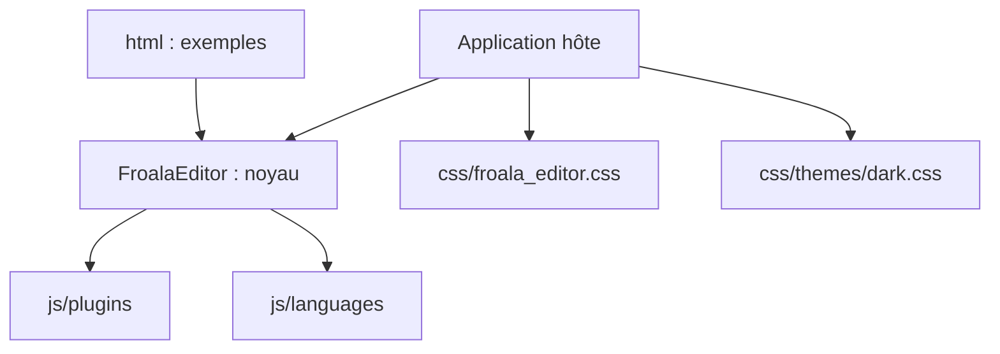

# froala/wysiwyg-editor

> Éditeur de texte riche WYSIWYG en JavaScript, vendu sous licence commerciale, avec plus de trente plugins.

## Le problème
Intégrer dans une application web un éditeur de texte riche complet, extensible et localisé.

## Ce que ça fait vraiment
On instancie `FroalaEditor` sur un textarea, puis on charge à la carte des plugins (images, tableaux, alignement…), des thèmes et des langues. Il se charge par npm, bower ou CDN, en AMD, CommonJS ou module ES, avec des déclarations TypeScript. Des exemples de serveurs PHP montrent l'envoi de médias vers un stockage compatible S3 ; des intégrations existent pour de nombreux frameworks.

## Comment c'est branché


## Essayer
```bash
npm install froala-editor
```
```javascript
new FroalaEditor('#edit');
```

## Coût et pièges
Payant : tous les plugins sont restreints sans licence ; un essai d'une durée limitée demande l'enregistrement d'une licence d'essai, puis une licence commerciale. La licence est « présente mais non identifiée » par GitHub, et plus de 430 issues sont ouvertes.

## Ce que ce n'est pas
Ce n'est pas un logiciel libre au sens usuel malgré la présence du code. Ce n'est pas un service d'upload : le stockage est à écrire côté serveur.

## Alternatives
Aucune alternative nommée dans le README.

## Pour toi
À ignorer : éditeur commercial sous licence, inutile pour un profil data ou IA, qui n'a pas à payer pour un composant web.

