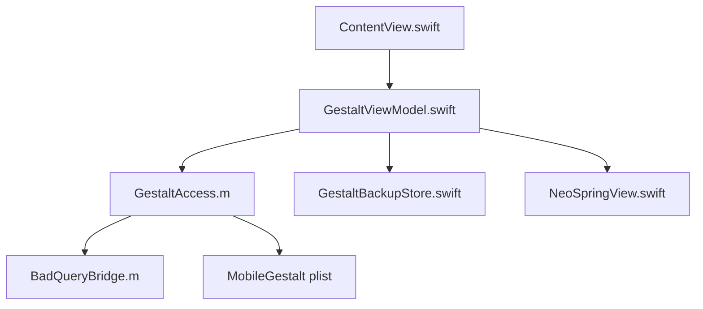

# frs0n/GestaltEdit

> iPhone and iPad app that edits the MobileGestalt file to enable system features, for iOS tinkerers.

## The problem
Enabling hidden iOS capabilities (Dynamic Island, Action button) requires modifying a system file.

## What it actually does
Edits `com.apple.MobileGestalt.plist` on the device, with presets, a field editor, automatic backups and restore. According to the code, the view model applies changes through `GestaltAccess`, which reads, writes and verifies the file; a launch command sets the Siri region.

## How it is wired

## Trying it
No command: download `GestaltEdit.ipa` from Releases, sign it with iLoader, then trust the certificate in Settings.

## Cost and gotchas
Free. Requires iOS or iPadOS 26.0, developer mode and an Apple ID for signing. Uses private APIs: bad values can break the system and force you to restore the device. GPL-3.0 license.

## What it is not
Not a tool supported by Apple: it is not affiliated with them and should only be used on your own devices.

## Alternatives
Nugget, cited in the credits for the presets and iPadOS.

## For you
Ignore: risky iOS tinkering, unrelated to data or AI.
