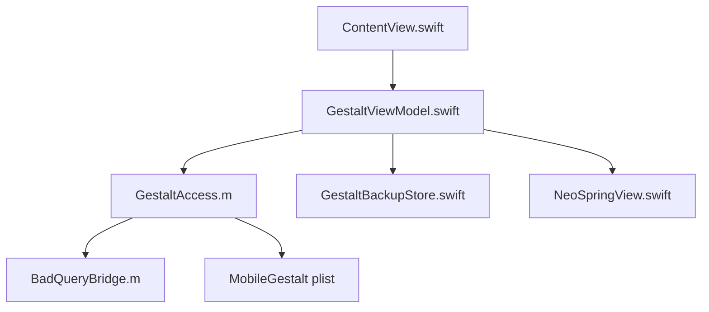

# frs0n/GestaltEdit

> App iPhone et iPad qui édite le fichier MobileGestalt pour activer des fonctions système, pour bricoleurs iOS.

## Le problème
Activer des capacités cachées d'iOS (Dynamic Island, bouton Action) demande de modifier un fichier système.

## Ce que ça fait vraiment
Édite `com.apple.MobileGestalt.plist` sur l'appareil, avec préréglages, éditeur de champs, sauvegardes automatiques et restauration. D'après le code, le modèle de vue applique les modifications via `GestaltAccess`, qui lit, écrit et vérifie le fichier ; une commande de lancement règle la région Siri.

## Comment c'est branché

## Essayer
Aucune commande : télécharger `GestaltEdit.ipa` depuis Releases, le signer avec iLoader, puis faire confiance au certificat dans Réglages.

## Coût et pièges
Gratuit. Exige iOS ou iPadOS 26.0, le mode développeur et un Apple ID pour signer. Utilise des API privées : de mauvaises valeurs peuvent casser le système et obliger à restaurer l'appareil. Licence GPL-3.0.

## Ce que ce n'est pas
Pas un outil supporté par Apple : il n'y est pas affilié et ne doit servir que sur tes appareils.

## Alternatives
Nugget, cité dans les crédits pour les préréglages et l'iPadOS.

## Pour toi
À ignorer : bricolage iOS risqué, sans lien avec la data ou l'IA.

