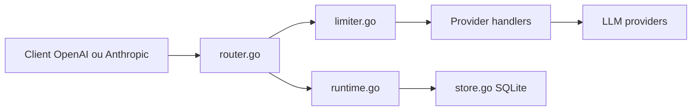

# fruitbars/simple-one-api

> A multi-provider LLM gateway in Go, with key pool, rate limits and web console, for hosters.

## The problem
Juggling several providers and API keys, with bursts of 429s as soon as requests are large.

## What it actually does
Exposes `/v1/chat/completions`, `/v1/responses`, `/v1/messages` and embeddings in front of several providers. A key pool picks the key that can absorb the request (token estimate, 60 s window), cools down on 429 and fails over. QPS/RPM/TPM/concurrency limits on four levels, embedded React console, config in SQLite, usage stats without prompts, Wails desktop app.

## How it is wired


## Trying it
```bash
docker pull ghcr.io/fruitbars/simple-one-api:latest
docker run -d --name simple-one-api -p 9090:9090 \
  -v /absolute/path/config.json:/app/config.json:ro \
  -v /absolute/path/data:/app/data \
  -e SIMPLE_ONE_API_DB=/app/data/config.db \
  ghcr.io/fruitbars/simple-one-api:latest
```

## Cost and gotchas
Your own upstream keys. SQLite without encryption at rest; the capacity state lives in memory and is lost on restart. The provider docs in the repository may be outdated.

## What it is not
Not a billing tool: the displayed capacities come from a local window, not from the provider's balance. README in Chinese first.

## Alternatives
No alternative named in the README.

## For you
Worth watching: capacity-aware TPM routing solves a real 429 problem on large contexts, but single maintainer and a README with no comparison; test it only if you pool keys.
