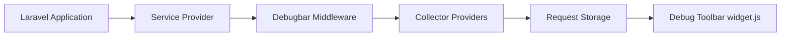

# fruitcake/laravel-debugbar

> Debug bar for Laravel applications: SQL queries, views, logs, timing, memory.

## The problem
Understanding why a Laravel page is slow or what it executes forces you to add `dump` calls everywhere.

## What it actually does
A ServiceProvider injects a bar into the HTML response; collectors capture queries (with bindings and duration), routes, views, events, logs, mails, cache, memory, exceptions. Previous requests are stored and can be browsed; an "explain" of queries is offered. A `Debugbar` facade for messages and measurements, Twig extensions, optional Clockwork/Telescope views.

## How it is wired


## Trying it
```shell
composer require fruitcake/laravel-debugbar --dev
php artisan vendor:publish --provider='Fruitcake\LaravelDebugbar\ServiceProvider'
```

## Cost and gotchas
Free. The README warns: development only; the bar leaks query information by design and slows the application down. Active when `APP_DEBUG=true` outside production.

## What it is not
Not a production observability tool nor a distributed profiler.

## Alternatives
Clockwork and Telescope, mentioned as optional views.

## For you
Of no interest outside the PHP/Laravel ecosystem: ignore.
