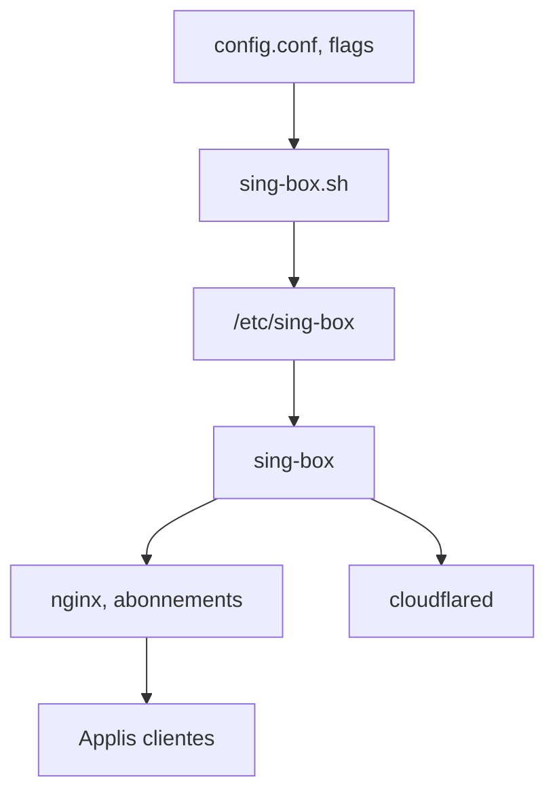

# fscarmen/sing-box

> Script to install and manage a multi-protocol sing-box proxy server on a VPS or Docker.

## The problem
Manually configuring a multi-protocol proxy server, its certificates and client subscriptions is slow and fragile.

## What it actually does
The sing-box.sh script installs sing-box (plus nginx and cloudflared as options), assembles the configuration from JSON fragments and generates outputs for clients (v2rayN, Clash, Shadowrocket...). About fifteen protocols to choose from, Cloudflare Argo tunnels, interactive or non-interactive installation, Docker version.

## How it is wired


## Trying it
```bash
bash <(wget -qO- https://raw.githubusercontent.com/fscarmen/sing-box/main/sing-box.sh)
sb
```

## Cost and gotchas
Free, but you need a VPS, and a Cloudflare account for Argo. The script runs from a remote URL with root privileges: read it before running. README in Chinese and English.

## What it is not
Not a product but a shell script maintained by one person. The intended use is network circumvention, unrelated to data or AI. The README is truncated in the fiche.

## Alternatives
No alternative named in the README.

## For you
Ignore: a proxy administration tool unrelated to your field, which requires running a remote script as root.
