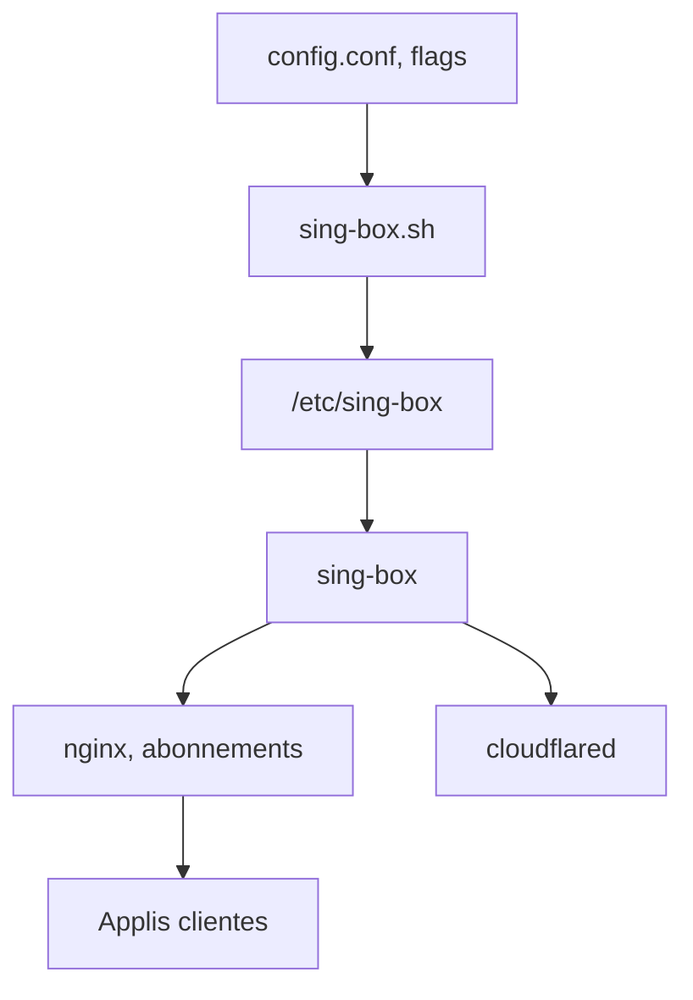

# fscarmen/sing-box

> Script d'installation et de gestion d'un serveur proxy sing-box multi-protocoles sur VPS ou Docker.

## Le problème
Configurer à la main un serveur proxy multi-protocoles, ses certificats et les abonnements clients est long et fragile.

## Ce que ça fait vraiment
Le script sing-box.sh installe sing-box (plus nginx et cloudflared en option), assemble la configuration par fragments JSON et génère les sorties pour les clients (v2rayN, Clash, Shadowrocket...). Une quinzaine de protocoles au choix, tunnels Cloudflare Argo, installation interactive ou sans interaction, version Docker.

## Comment c'est branché


## Essayer
```bash
bash <(wget -qO- https://raw.githubusercontent.com/fscarmen/sing-box/main/sing-box.sh)
sb
```

## Coût et pièges
Gratuit, mais il faut un VPS, et un compte Cloudflare pour Argo. Le script s'exécute depuis une URL distante avec des droits root : à lire avant de lancer. README en chinois et anglais.

## Ce que ce n'est pas
Pas un produit mais un script shell tenu par une personne. L'usage visé est le contournement réseau, sans rapport avec la data ou l'IA. Le README est tronqué dans la fiche.

## Alternatives
Aucune alternative nommée dans le README.

## Pour toi
À ignorer : outil d'administration de proxy sans lien avec ton métier, qui demande de lancer un script distant en root.

