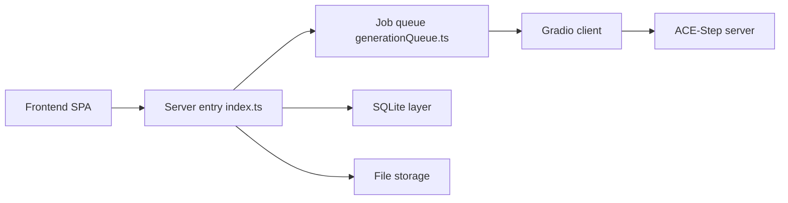

# fspecii/ace-step-ui

> Local web interface to generate music with the ACE-Step 1.5 model, on your own GPU.

## The problem
The ACE-Step model only offers a raw Gradio server; it lacks a library, a player and audio tools.

## What it actually does
A React SPA calls an Express/SQLite backend, whose `generationQueue.ts` and `gradio-client.ts` forward jobs to the ACE-Step server (port 8001). It adds playlists, likes, an AudioMass editor, Demucs track separation and videos with Pexels backgrounds. A `geminiService.ts` exists on the frontend side, with no detail in the README.

## How it is wired


## Trying it
```bash
git clone https://github.com/fspecii/ace-step-ui
cd ace-step-ui
./setup.sh
./start-all.sh
```

## Cost and gotchas
ACE-Step 1.5 must be installed separately (models of about 5 GB) and an NVIDIA GPU with at least 4 GB, 12 GB for LLM mode. Pexels asks for an optional key. No license declared.

## What it is not
It is not the model: without ACE-Step running, the interface is useless. The README's comparisons with Suno are marketing. The README ends with an offer of web services from the same author.

## Alternatives
- ACE-Step-1.5: the engine itself, without an interface.
- Pinokio: one-click installation mentioned in the README.

## For you
Worth watching: handy for testing a local music model, but no license and dependence on a third-party project.
