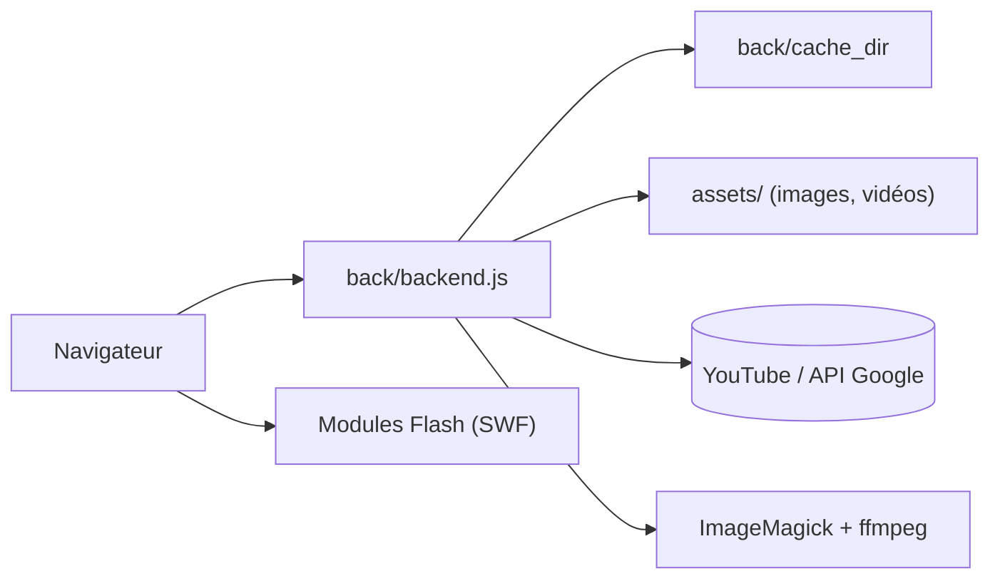

# ftde0/yt2009

> Fairly faithful reconstruction of the 2009 YouTube interface, with account features, to self-host.

## The problem
Getting back the 2009 YouTube interface and Flash player with current videos, without the original site allowing it.

## What it actually does
A Node.js server (`back/backend.js`) serves 2009 HTML pages and Flash modules, fetches video data from YouTube (Google Data API v3 key recommended, Wayback Machine source possible), caches, and downloads images and videos through ImageMagick and ffmpeg. Signing in to a real YouTube account is possible. Docker option provided.

## How it is wired


## Trying it
```bash
npm install --allow-git=root
node yt2009setup.js
node post_config_setup.js
cd back
node backend.js
git pull --no-commit
```

## Cost and gotchas
Free; ImageMagick, ffmpeg and Node required. Disk space can reach tens of GB. Changes on the YouTube side regularly break the tool, hence updating via git.

## What it is not
It is not an official or stable service: the README announces frequent breakages. Compliance with YouTube's terms of use is not addressed.

## Alternatives
The README cites no alternative.

## For you
Ignore: a web-nostalgia project, unrelated to data/AI/MLOps work.
