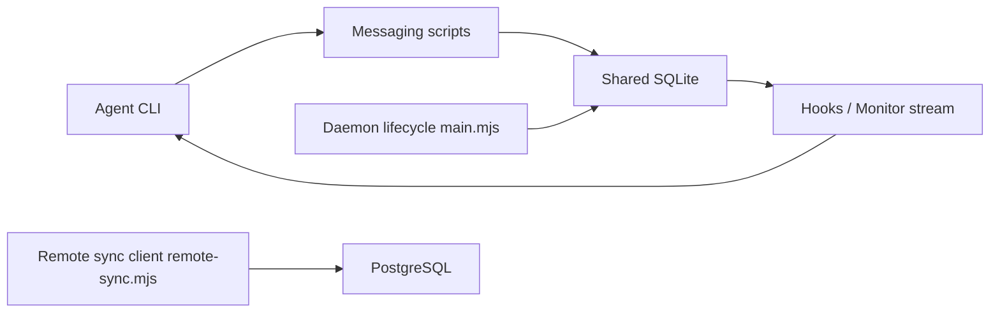

# fujibee/agmsg

> Local messaging between CLI agents (Claude Code, Codex, Gemini…), through a shared SQLite database.

## The problem
When several agents from different tools work together, the human copy-pastes messages between them.

## What it actually does
Bash and `sqlite3` scripts: each agent has a hook or a Monitor stream that reads a WAL SQLite database and displays incoming messages. Teams, roles (`actas`), agent launching (`spawn`, `despawn`), history, several delivery modes. An optional daemon (agmsgd, beta) exists, as well as a remote sync server.

## How it is wired


## Trying it
```bash
npx agmsg
npx agmsg@latest install --update
agmsg daemon status
bats tests/
```

## Cost and gotchas
Free. Requires `bash` and `sqlite3`; Git Bash on Windows. The Claude Code and Codex sandboxes must allow writing to `~/.agents/skills/agmsg/`. 357 open issues. The daemon requires Node >= 22.13.

## What it is not
Neither MCP, nor subagents, nor a message queue with a broker. No task lock: two agents subscribed to the same name see the same message. Loop stops are handled in the prompts.

## Alternatives
No alternative named in the README.

## For you
Watch: useful to orchestrate several agents without a server, but the whole is young, fast-changing and carried by a single person.
