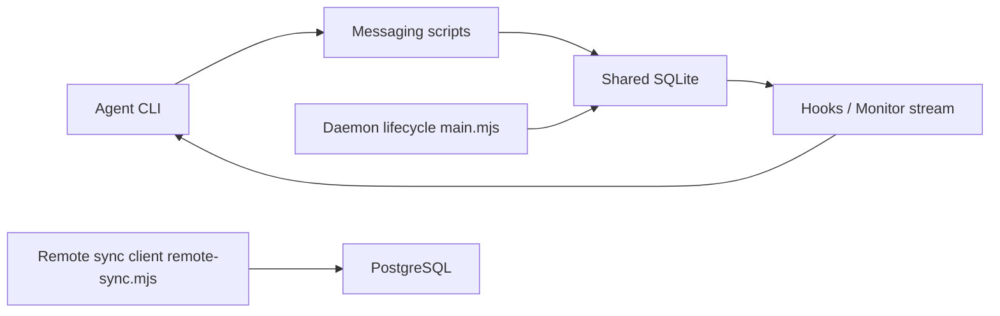

# fujibee/agmsg

> Messagerie locale entre agents CLI (Claude Code, Codex, Gemini…), via une base SQLite partagée.

## Le problème
Quand plusieurs agents d'outils différents travaillent ensemble, c'est l'humain qui copie-colle les messages entre eux.

## Ce que ça fait vraiment
Scripts bash et `sqlite3` : chaque agent a un hook ou un flux Monitor qui lit une base SQLite WAL et affiche les messages entrants. Équipes, rôles (`actas`), lancement d'agents (`spawn`, `despawn`), historique, plusieurs modes de livraison. Un daemon optionnel (agmsgd, beta) existe, ainsi qu'un serveur de synchronisation distant.

## Comment c'est branché


## Essayer
```bash
npx agmsg
npx agmsg@latest install --update
agmsg daemon status
bats tests/
```

## Coût et pièges
Gratuit. Il faut `bash` et `sqlite3` ; Git Bash sous Windows. Les bacs à sable de Claude Code et Codex doivent autoriser l'écriture dans `~/.agents/skills/agmsg/`. 357 issues ouvertes. Le daemon demande Node >= 22.13.

## Ce que ce n'est pas
Ni MCP, ni sous-agents, ni file de messages avec broker. Pas de verrou de tâche : deux agents abonnés au même nom voient le même message. Les arrêts de boucle se règlent dans les prompts.

## Alternatives
Aucune alternative nommée dans le README.

## Pour toi
Surveiller : utile pour orchestrer plusieurs agents sans serveur, mais l'ensemble est jeune, très évolutif et porté par une seule personne.

