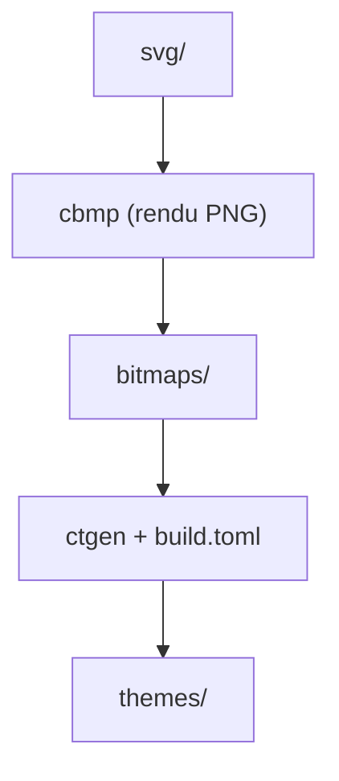

# ful1e5/Bibata_Cursor

> Material mouse cursor set, in SVG, installable on Linux and Windows.

## The problem
Default cursors are hard to customize in color and size, especially on Linux.

## What it actually does
The repository contains the cursor SVGs and the build configuration (build.toml). Six variants (Original or Modern, in Amber, Classic, Ice), with left-handed versions. Two external tools produce the themes: cbmp renders the PNGs while changing colors, and ctgen builds the XCursor and Windows cursors. The author announces that main development has moved to the bibata project.

## How it is wired
Simplified diagram based on the fiche, no diagram provided.


## Trying it
```bash
tar -xvf Bibata.tar.gz
mv Bibata-* ~/.local/share/icons/
git clone https://github.com/ful1e5/Bibata_Cursor
yarn install
yarn generate
```

## Cost and gotchas
Free. Building requires Python 3.7 or later, clickgen and yarn. Windows: install via install.inf with system authorization.

## What it is not
It is not code: it is desktop theming. The repository is now mostly maintained for Linux packages; new work is elsewhere.

## Alternatives
bibata (successor named in the README): new features and download.

## For you
Ignore: no link to data or AI, it is a desktop theme.
