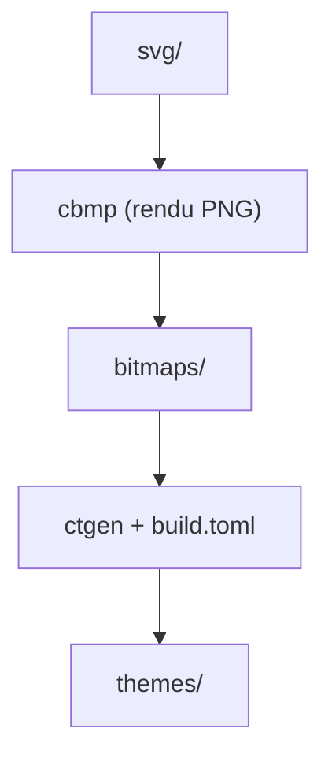

# ful1e5/Bibata_Cursor

> Jeu de curseurs de souris Material, en SVG, installable sur Linux et Windows.

## Le problème
Les curseurs par défaut sont peu personnalisables en couleur et en taille, surtout sous Linux.

## Ce que ça fait vraiment
Le dépôt contient les SVG des curseurs et la configuration de construction (build.toml). Six variantes (Original ou Modern, en Amber, Classic, Ice), avec versions pour gauchers. Deux outils externes produisent les thèmes : cbmp rend les PNG en changeant les couleurs, ctgen construit les XCursor et curseurs Windows. L'auteur annonce que le développement principal est passé au projet bibata.

## Comment c'est branché
Schéma simplifié d'après la fiche, sans diagramme fourni.


## Essayer
```bash
tar -xvf Bibata.tar.gz
mv Bibata-* ~/.local/share/icons/
git clone https://github.com/ful1e5/Bibata_Cursor
yarn install
yarn generate
```

## Coût et pièges
Gratuit. La construction demande Python 3.7 ou plus, clickgen et yarn. Windows : installer via install.inf avec autorisation système.

## Ce que ce n'est pas
Ce n'est pas du code : c'est de l'habillage de bureau. Le dépôt est désormais surtout maintenu pour les paquets Linux ; les nouveautés sont ailleurs.

## Alternatives
bibata (successeur nommé dans le README) : nouvelles fonctions et téléchargement.

## Pour toi
Ignorer : aucun lien avec la donnée ou l'IA, c'est un thème de bureau.

