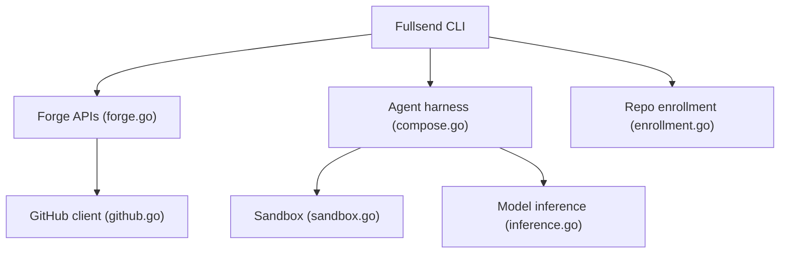

# fullsend-ai/fullsend

> Autonomous agents that triage, implement, review and merge code for Git organizations.

## The problem
The issue → code → review → merge flow involves humans at every step; automating it raises security questions.

## What it actually does
The (short) README announces agents for GitHub, GitLab, Forgejo, "secure by design", and points to fullsend.sh. From the code: a CLI, an agent harness with sandbox, a Jira poller, repository enrollment, a skill-retrieval service and a token service. Details not documented in the README.

## How it is wired

## Trying it
No command documented in the README: see fullsend.sh (getting-started guides).

## Cost and gotchas
Model inference probably at your expense and write access to your repositories; not quantified in the README. 1,929 open issues.

## What it is not
Not usage documentation: the README is a pointer. "Merge to production autonomously" is a promise that cannot be verified here.

## Alternatives
No alternative named in the README.

## For you
Worth watching: a relevant topic for MLOps (agents + execution security) and active, but you need to read fullsend.sh before judging.
