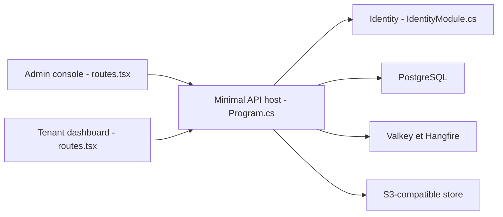

# fullstackhero/dotnet-starter-kit

> Multi-tenant .NET 10 template with two React applications, for launching a SaaS.

## The problem
Common templates provide a login and a to-do list, never the hard parts: multi-tenancy, billing, auditing.

## What it actually does
The `fsh` CLI generates the full source code: Minimal APIs API, modules (Identity, Multitenancy, Billing, Catalog, Tickets, Chat, Files, Webhooks, Auditing, Notifications), EF Core on PostgreSQL, Valkey cache, Hangfire, S3 storage. .NET Aspire orchestrates everything locally; Docker Compose and Terraform AWS for deployment. The README claims more than 1,600 backend tests.

## How it is wired


## Trying it
```bash
dotnet tool install -g FullStackHero.CLI
fsh new MyApp
cd MyApp
dotnet run --project src/Host/MyApp.AppHost
```

## Cost and gotchas
.NET 10 SDK, Docker, Node 20+. Demo passwords in the README (to be changed). Several modules were not inspected.

## What it is not
Not a ready-made SaaS product: it is a starting point. "Production-ready" is the README's slogan, unverified.

## Alternatives
No alternative named in the README.

## For you
Ignore: a .NET SaaS template with no link to data/AI/MLOps.
