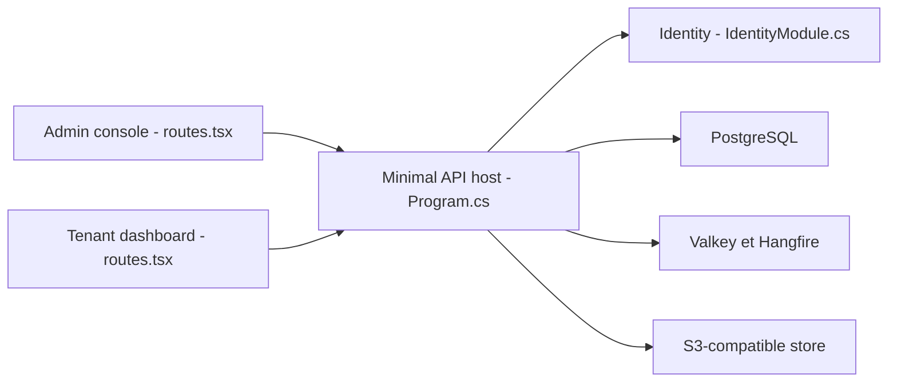

# fullstackhero/dotnet-starter-kit

> Gabarit .NET 10 multi-tenant avec deux applications React, pour lancer un SaaS.

## Le problème
Les gabarits courants fournissent un login et une liste de tâches, jamais les parties difficiles : multi-locataires, facturation, audit.

## Ce que ça fait vraiment
La CLI `fsh` génère le code source complet : API Minimal APIs, modules (Identity, Multitenancy, Billing, Catalog, Tickets, Chat, Files, Webhooks, Auditing, Notifications), EF Core sur PostgreSQL, cache Valkey, Hangfire, stockage S3. .NET Aspire orchestre tout en local ; Docker Compose et Terraform AWS pour le déploiement. Le README annonce plus de 1 600 tests backend.

## Comment c'est branché


## Essayer
```bash
dotnet tool install -g FullStackHero.CLI
fsh new MyApp
cd MyApp
dotnet run --project src/Host/MyApp.AppHost
```

## Coût et pièges
SDK .NET 10, Docker, Node 20+. Mots de passe de démonstration dans le README (à changer). Plusieurs modules n'ont pas été inspectés.

## Ce que ce n'est pas
Pas un produit SaaS déjà prêt : c'est un point de départ. « Production-ready » est le slogan du README, non vérifié.

## Alternatives
Aucune alternative nommée dans le README.

## Pour toi
À ignorer : gabarit de SaaS .NET sans lien avec data/IA/MLOps.

