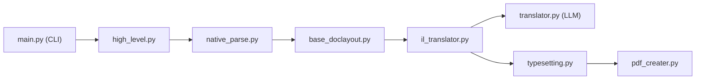

# funstory-ai/BabelDOC

> Library and CLI that translate scientific PDFs while preserving layout, for integrators.

## The problem
Translating a PDF paper with formulas, tables and figures breaks the layout. Conversion services lose the original structure or are expensive.

## What it actually does
Parses the PDF into an intermediate representation, detects the layout (layout model, RPC possible) and paragraphs, translates via an OpenAI-compatible LLM, then recomposes a monolingual or bilingual PDF. Glossary (CSV and automatic extraction), splitting of large documents, OCR workaround for scans. The README says the CLI is mainly intended for debugging and that the Python API is internal and unsupported.

## How it is wired


## Trying it
```bash
uv tool install --python 3.12 BabelDOC
babeldoc --help
babeldoc --openai --openai-model "gpt-4o-mini" --openai-base-url "https://api.openai.com/v1" --openai-api-key "your-api-key-here" --files example.pdf
```

## Cost and gotchas
LLM calls are at your expense (the only supported engine is an OpenAI-compatible API). Models and fonts are downloaded on first run (`--warmup`, offline package possible).

## What it is not
Not a finished product: no technical support for the CLI according to the README. Mostly tested English→Chinese. Known limitations: authors/references merged, lines and drop caps not handled, large pages ignored. AGPL-3.0: restrictive if you embed it in a service.

## Alternatives
- PDFMathTranslate (2.0): standalone deployment with a WebUI and more translation engines.
- Immersive Translate: online service with a free quota.

## For you
Watch: useful for translating research papers with an LLM API, but the internal API is unstable and the license is AGPL, so prefer PDFMathTranslate for a turnkey use.
