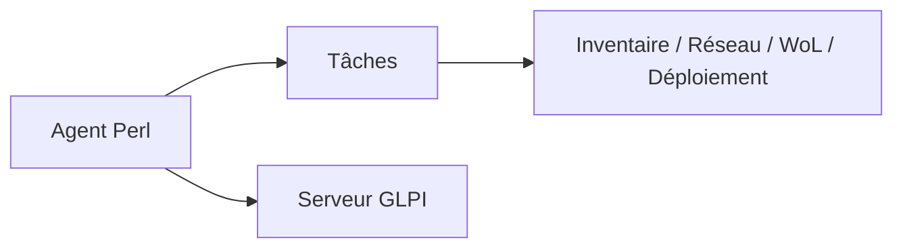

# fusioninventory/fusioninventory-agent

> Generic Perl inventory and fleet-management agent, driven by a GLPI server.

## The problem
Listing the hardware and software of an IT fleet requires an agent on every machine.

## What it actually does
Runs tasks: inventory, network discovery, network inventory (SNMP), Wake on LAN, deployment (with P2P). Can run standalone or for a GLPI server with the fusioninventory plugin. The README mostly lists the required Perl modules.

## How it is wired

## Trying it
No command documented in this README.

## Cost and gotchas
Free, Perl 5.8 minimum. Last push August 2023; GPL-2.0 license.

## What it is not
Not an ML observability solution; it is fleet management.

## Alternatives
No alternative named in the README.

## For you
Ignore: old fleet management, outside the data/AI/MLOps profile.
