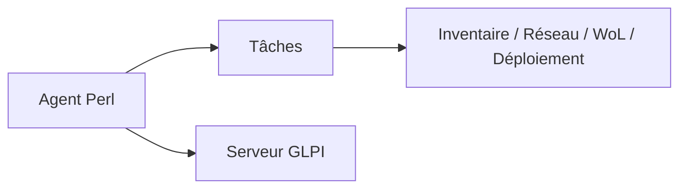

# fusioninventory/fusioninventory-agent

> Agent Perl générique d'inventaire et de gestion de parc, piloté par un serveur GLPI.

## Le problème
Recenser matériel et logiciels d'un parc informatique demande un agent sur chaque poste.

## Ce que ça fait vraiment
Exécute des tâches : inventaire, découverte réseau, inventaire réseau (SNMP), réveil par LAN (Wake on LAN), déploiement (avec P2P). Peut fonctionner seul ou pour un serveur GLPI avec le plugin fusioninventory. Le README liste surtout les modules Perl requis.

## Comment c'est branché

## Essayer
Aucune commande documentée dans ce README.

## Coût et pièges
Gratuit, Perl 5.8 minimum. Dernier push août 2023 ; licence GPL-2.0.

## Ce que ce n'est pas
Pas une solution d'observabilité ML ; c'est de la gestion de parc.

## Alternatives
Aucune alternative nommée dans le README.

## Pour toi
À ignorer : gestion de parc ancienne, hors profil data/IA/MLOps.

