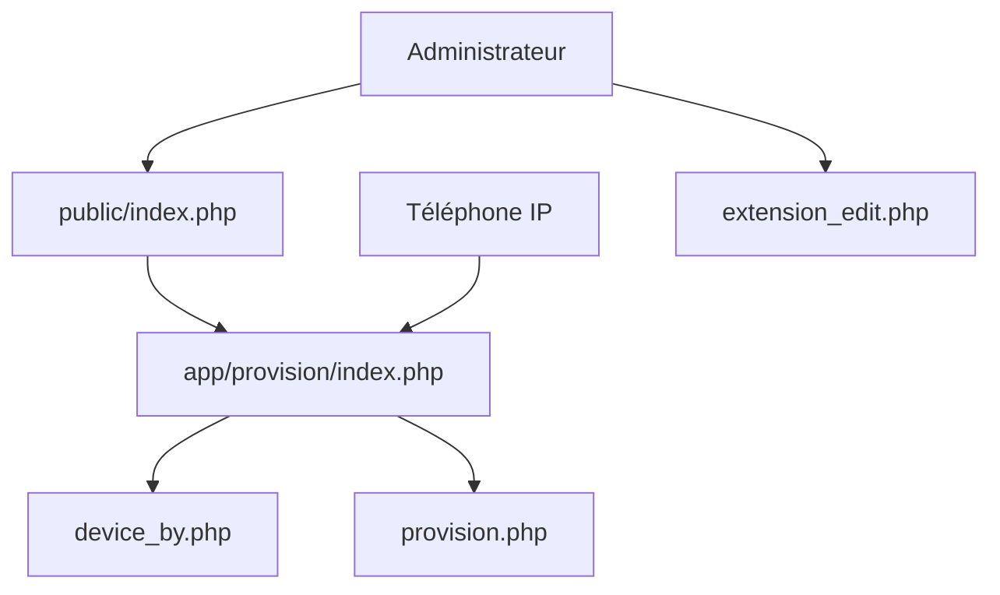

# fusionpbx/fusionpbx

> Multi-tenant telephone PBX web interface on top of FreeSWITCH, for VoIP operators and integrators.

## The problem
Administering FreeSWITCH through configuration files is cumbersome for managing extensions, dial plans and phones.

## What it actually does
- Unlimited extensions, voicemail to email, interactive voice response, call groups, call center queues.
- Programmable dial plans, conferences, fax, music on hold.
- IP phone provisioning through generated files.
- Installers for Debian, Ubuntu, FreeBSD and CentOS.

## How it is wired


## Trying it
```bash
wget -O - https://raw.githubusercontent.com/fusionpbx/fusionpbx-install.sh/master/debian/pre-install.sh | sh;
cd /usr/src/fusionpbx-install.sh/debian && ./install.sh
```

## Cost and gotchas
The code is openly accessible, but the REST API and the advanced call center are reserved for subscriptions of 100 to 1000 dollars per month, with a one-year commitment. Installation as root.

## What it is not
Not a standalone product: it depends on FreeSWITCH. The README declares no license; a contribution requires a contributor license agreement.

## Alternatives
No alternative named in the README.

## For you
Ignore: business telephony, outside the data, AI or MLOps field.
