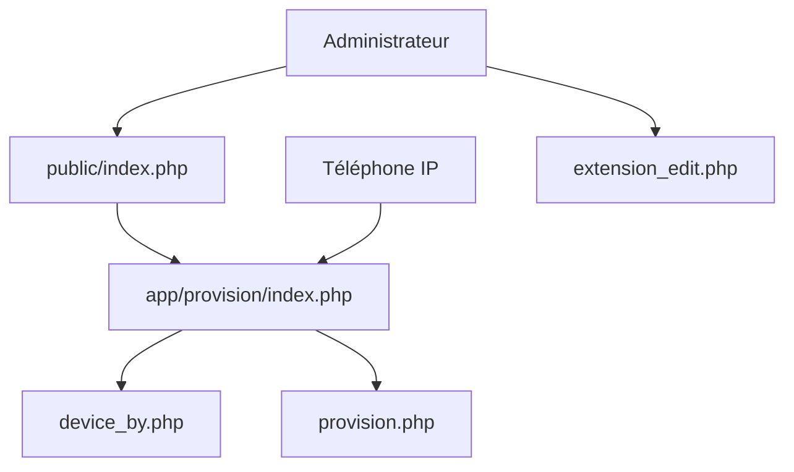

# fusionpbx/fusionpbx

> Interface web de PBX téléphonique multi-locataire au-dessus de FreeSWITCH, pour opérateurs et intégrateurs VoIP.

## Le problème
Administrer FreeSWITCH en fichiers de configuration est lourd pour gérer extensions, plans d'appel et téléphones.

## Ce que ça fait vraiment
- Extensions illimitées, messagerie vocale vers courriel, serveur vocal interactif, groupes d'appel, files de centre d'appels.
- Plans de numérotation programmables, conférences, fax, musique d'attente.
- Provisionnement de téléphones IP par fichiers générés.
- Installateurs pour Debian, Ubuntu, FreeBSD et CentOS.

## Comment c'est branché


## Essayer
```bash
wget -O - https://raw.githubusercontent.com/fusionpbx/fusionpbx-install.sh/master/debian/pre-install.sh | sh;
cd /usr/src/fusionpbx-install.sh/debian && ./install.sh
```

## Coût et pièges
Le code est libre d'accès mais l'API REST et le centre d'appels avancé sont réservés aux abonnements de 100 à 1000 dollars par mois, avec engagement d'un an. Installation en root.

## Ce que ce n'est pas
Pas un produit autonome : il dépend de FreeSWITCH. Le README ne déclare pas de licence ; une contribution exige un accord de licence de contributeur.

## Alternatives
Aucune alternative nommée dans le README.

## Pour toi
À ignorer : téléphonie d'entreprise, hors du champ data, IA ou MLOps.

