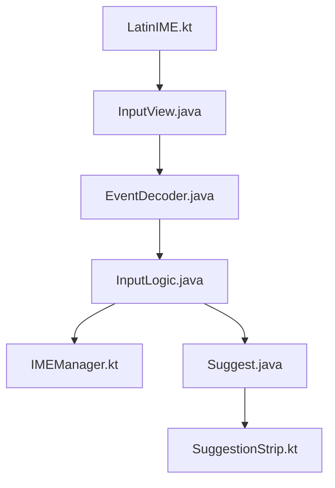

# futo-org/android-keyboard

> Offline Android keyboard, derived from LatinIME, for those who want to type without being spied on.

## The problem
Common mobile keyboards often send what you type to the cloud.

## What it actually does
A fork of LatinIME with significant changes. It supports configurable layouts, dictionary-based prediction, a spell checker and voice input with a model manager (ModelManager). Nightly builds are available as APKs.

## How it is wired


## Trying it
```bash
git clone --recursive https://gitlab.futo.org/keyboard/latinime.git
./gradlew assembleUnstableDebug
./gradlew assembleStableRelease
```

## Cost and gotchas
Free. License "FUTO Source First License 1.1", not recognized by GitHub: read it before any commercial use or redistribution. The clone must be recursive.

## What it is not
Not a classic open source license. Not a data or AI project, despite the voice input.

## Alternatives
No alternative named in the README (LatinIME, the upstream, is cited as the base).

## For you
Ignore: a consumer tool outside your data/AI/MLOps scope, with a license containing particular clauses.
