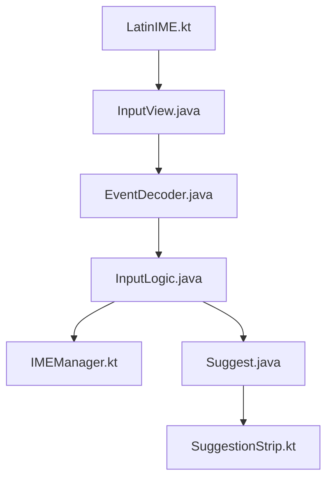

# futo-org/android-keyboard

> Clavier Android hors ligne, dérivé de LatinIME, pour qui veut écrire sans être espionné.

## Le problème
Les claviers mobiles courants envoient souvent ce que vous tapez vers le cloud.

## Ce que ça fait vraiment
Fork de LatinIME avec des changements importants. Il gère les dispositions configurables, la prédiction par dictionnaires, le correcteur orthographique et la saisie vocale avec un gestionnaire de modèles (ModelManager). Les builds nightly sont disponibles en APK.

## Comment c'est branché


## Essayer
```bash
git clone --recursive https://gitlab.futo.org/keyboard/latinime.git
./gradlew assembleUnstableDebug
./gradlew assembleStableRelease
```

## Coût et pièges
Gratuit. Licence « FUTO Source First License 1.1 », non reconnue par GitHub : à lire avant tout usage commercial ou redistribution. Le clone doit être récursif.

## Ce que ce n'est pas
Pas une licence open source classique. Pas un projet de data ou d'IA, malgré la saisie vocale.

## Alternatives
Aucune alternative nommée dans le README (LatinIME, l'amont, est cité comme base).

## Pour toi
À ignorer : outil grand public hors de ton périmètre data/IA/MLOps, avec une licence à clauses particulières.

