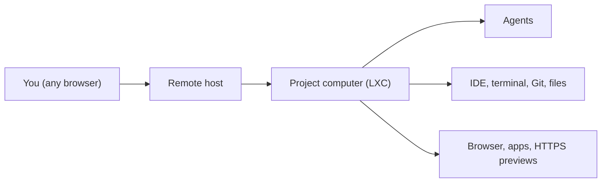

# futrx-com/remote.futrx

> Self-hosted platform that gives each project a Linux container where code agents work, driven from a browser.

## The problem
Code agents run on your laptop, with no durable, shareable environment isolated per project.

## What it actually does
One unprivileged LXC container per project, with agent chat (Codex, MiniMax, Claude Code, Kimi, Antigravity), browser IDE, terminal, files, Git, HTTPS previews and a shared browser. Scheduled tasks, per-project secrets, members, 2FA, usage and cost tracking. Agents keep running when the laptop is closed.

## How it is wired


## Trying it
```bash
curl -fsSL https://remote.futrx.com/get | sudo bash -s -- remote.example.com
journalctl -u remote --since "-10 min" | grep -A2 "first-time setup"
sudo remote setup-token
sudo bash /opt/remote.futrx/infra/update.sh
```

## Cost and gotchas
Ubuntu/Debian server with root access, a domain name with wildcard subdomains, ports 80/443. The installer disables SSH password login. Agent providers' subscriptions or keys are at your expense; MiniMax requires a token-plan key.

## What it is not
Not an AI model nor strong isolation: containers share the host kernel, the administrator sees everything, secrets are readable by the agents. Storage is not a backup.

## Alternatives
No alternative named in the README.

## For you
Worth watching: relevant for an MLOps engineer who wants to host agent environments; examine the threat model and the unidentified license before use.
