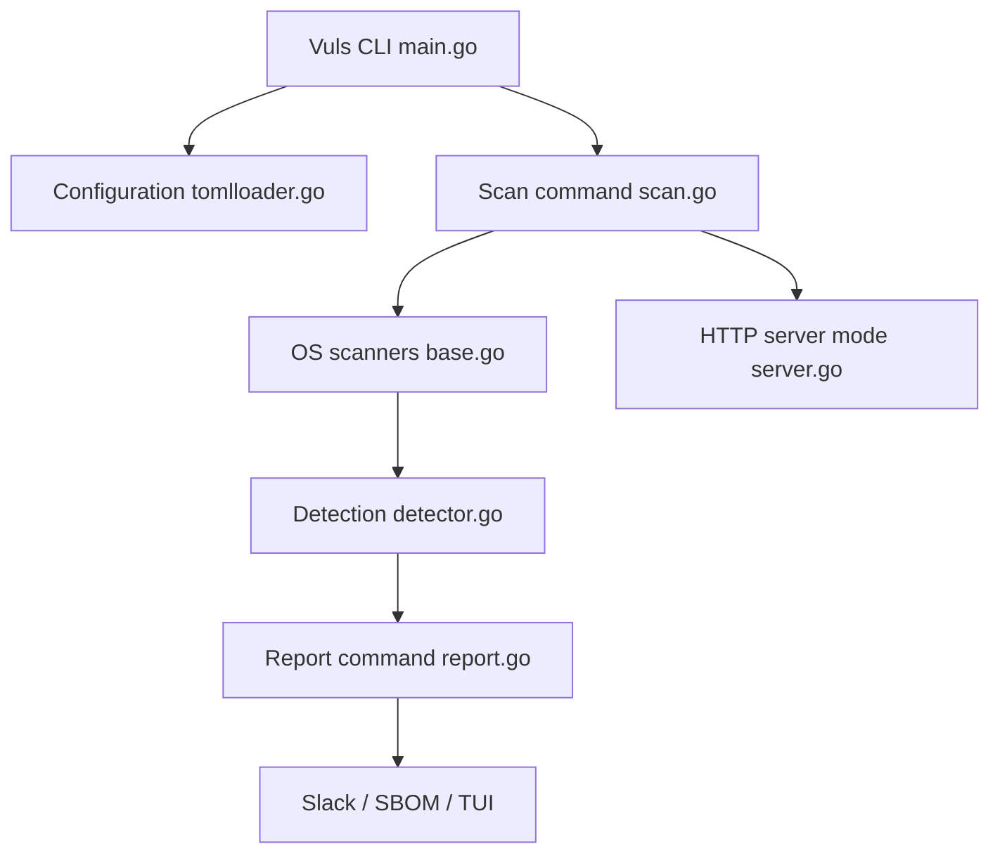

# future-architect/vuls

> Agentless vulnerability scanner in Go, for administrators of Linux, FreeBSD, Windows and macOS servers.

## The problem
Administrators have to track new vulnerabilities (NVD, etc.) by hand and work out which servers are affected, with the risk of missing some.

## What it actually does
Vuls collects the list of software on a system, cross-references it with vulnerability databases (NVD, JVN, OVAL, distribution advisories, KEV catalogs) and flags the affected servers. Three modes: remote scan over SSH, local scan, HTTP server mode. It also covers libraries (lock files), WordPress and CPE-based detection. Reports by e-mail, Slack, TUI or VulsRepo; SBOM output. It does not update packages.

## How it is wired

## Trying it
No command documented in the README: it points to vuls.io for installation and usage.

## Cost and gotchas
Free. You need to fetch the vulnerability databases (internet access, except offline mode for some distributions) and SSH access to the targets for remote mode. Use it only on systems you are responsible for; the README states that the scan is non-destructive.

## What it is not
Not a fixer: it does not update vulnerable packages. Not an attack tool: it detects and reports, even though its sources cite public PoCs and exploits as enrichment. GPL-3.0 license (copyleft).

## Alternatives
The README does not cite any competing tool; not documented.

## For you
Adopt it if you manage servers or training environments: automated, schedulable (cron/CI) CVE monitoring, with an active project (last push 2026-09-18).
