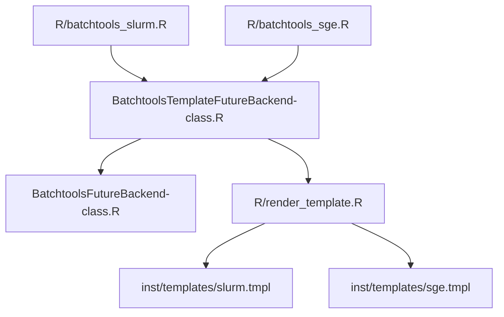

# futureverse/future.batchtools

> R backend for running futures on HPC clusters via batchtools, without changing the code.

## The problem
Running R code in parallel on a Slurm, SGE or LSF cluster forces you to write submission scripts by hand.

## What it actually does
Provides future plans such as batchtools_slurm, batchtools_sge, batchtools_lsf, batchtools_torque, batchtools_local and batchtools_custom. The HPC backends render a job script template before submitting the computation. Resources (time, memory, modules) are passed in plan().

## How it is wired


## Trying it
```r
install.packages("future.batchtools")
library(future)
plan(future.batchtools::batchtools_slurm)
f <- future({ Sys.sleep(5); 3.14 })
value(f)
```

## Cost and gotchas
You need a cluster with a scheduler; without a cluster, batchtools_local remains sequential. The license is not recognized by GitHub.

## What it is not
Not a scheduler: it submits jobs to Slurm or SGE, it does not replace them.

## Alternatives
- The future package: local plans or clusters without a scheduler.

## For you
Adopt if you do R on an HPC cluster: a simple change of plan() replaces submission scripts.
