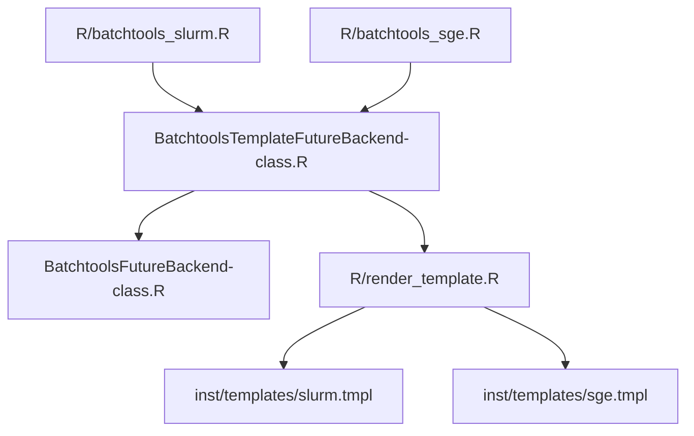

# futureverse/future.batchtools

> Backend R pour exécuter des futures sur des grappes HPC via batchtools, sans changer le code.

## Le problème
Faire tourner du code R en parallèle sur un cluster Slurm, SGE ou LSF oblige à écrire des scripts de soumission à la main.

## Ce que ça fait vraiment
Fournit des plans future comme batchtools_slurm, batchtools_sge, batchtools_lsf, batchtools_torque, batchtools_local et batchtools_custom. Les backends HPC rendent un gabarit de script de job avant de soumettre le calcul. Les ressources (temps, mémoire, modules) se passent dans plan().

## Comment c'est branché


## Essayer
```r
install.packages("future.batchtools")
library(future)
plan(future.batchtools::batchtools_slurm)
f <- future({ Sys.sleep(5); 3.14 })
value(f)
```

## Coût et pièges
Il faut un cluster avec un ordonnanceur ; sans cluster, batchtools_local reste séquentiel. La licence n'est pas reconnue par GitHub.

## Ce que ce n'est pas
Pas un ordonnanceur : il soumet des jobs à Slurm ou SGE, il ne les remplace pas.

## Alternatives
- Le paquet future : plans locaux ou cluster sans ordonnanceur.

## Pour toi
Adopter si tu fais du R sur un cluster HPC : un simple changement de plan() remplace des scripts de soumission.

