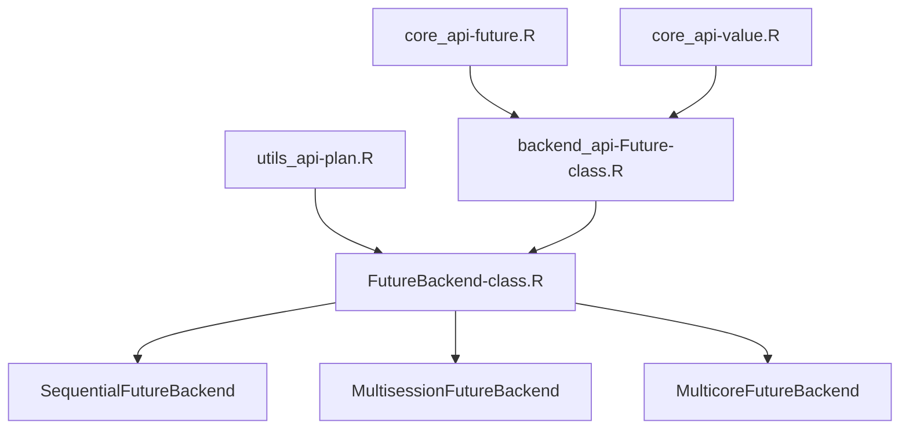

# futureverse/future

> R package unifying parallel and distributed computing through futures, for R data scientists.

## The problem
Parallelizing R code forces you to choose one API per machine or cluster and to rewrite code.

## What it actually does
A `future` is a value computed in the background; `plan()` chooses the backend: sequential (default), multisession, multicore, cluster, or extension packages (callr, mirai, batchtools for Slurm, SGE…). Evaluates in a local environment, detects global variables and evaluates only once. The `futurize` package parallelizes `lapply`, purrr and foreach.

## How it is wired


## Trying it
```r
library(futurize)
plan(multisession)
ys <- lapply(xs, slow_fcn) |> futurize()
```

## Cost and gotchas
Free. R is required; the install command does not appear in the part of the README that was read, which is truncated. Multicore is discouraged in RStudio and on Windows; globals that are too large trigger an error.

## What it is not
Not an engine for Python nor a scheduler: an abstraction layer that relies on the chosen backends.

## Alternatives
The future.callr, future.mirai and future.batchtools backends, named in the README.

## For you
Adopt if you work in R: parallelism with minimal changes and interchangeable backends, from a laptop to Slurm.
