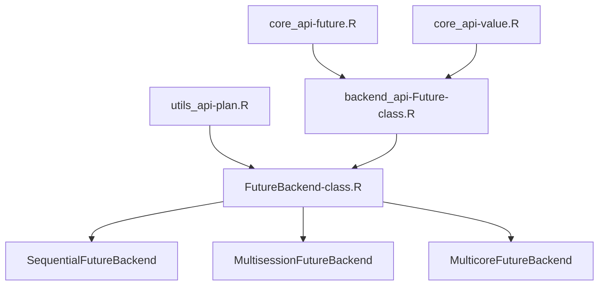

# futureverse/future

> Paquet R unifiant le calcul parallèle et distribué via des futurs, pour data scientists R.

## Le problème
Paralléliser du code R oblige à choisir une API par machine ou par grappe et à réécrire.

## Ce que ça fait vraiment
Une `future` est une valeur calculée en arrière-plan ; `plan()` choisit le backend : séquentiel (défaut), multisession, multicore, cluster, ou paquets d'extension (callr, mirai, batchtools pour Slurm, SGE…). Évalue en environnement local, détecte les variables globales et n'évalue qu'une fois. Le paquet `futurize` parallélise `lapply`, purrr et foreach.

## Comment c'est branché


## Essayer
```r
library(futurize)
plan(multisession)
ys <- lapply(xs, slow_fcn) |> futurize()
```

## Coût et pièges
Gratuit. Il faut R ; la commande d'installation n'apparaît pas dans la partie lue du README, qui est tronquée. Multicore est déconseillé dans RStudio et sous Windows ; les globaux trop volumineux déclenchent une erreur.

## Ce que ce n'est pas
Pas un moteur pour Python ni un ordonnanceur : une couche d'abstraction qui s'appuie sur les backends choisis.

## Alternatives
Les backends future.callr, future.mirai et future.batchtools, nommés dans le README.

## Pour toi
À adopter si tu travailles en R : parallélisme à changement minimal et backends interchangeables, du portable à Slurm.

