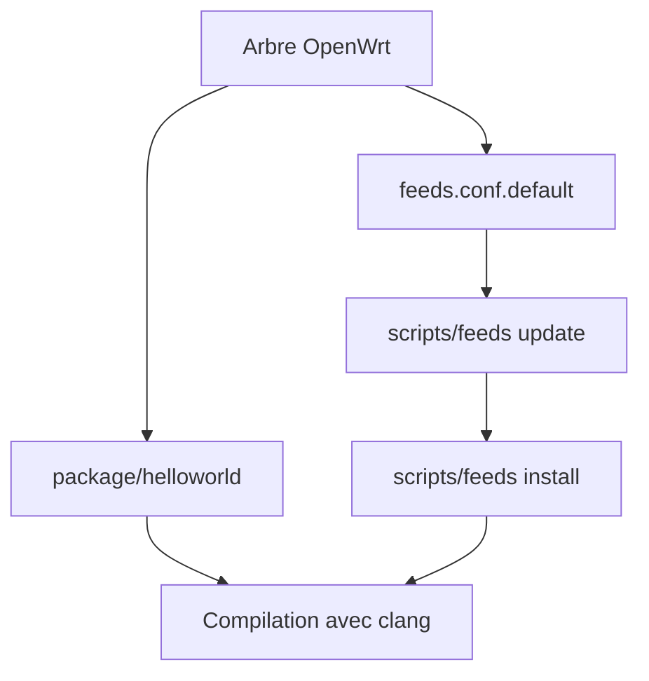

# fw876/helloworld

> Package repository to integrate into an OpenWrt build, by cloning, submodule or feed.

## The problem
Adding third-party packages to a self-built OpenWrt firmware requires wiring them properly into the build tree.

## What it actually does
The README only describes installation: three methods (clone into `package/helloworld`, git submodule, OpenWrt feed), with update and removal for each. It mentions Xray-core, which must be built with Go 1.21 or later on OpenWrt 21.02 and earlier. The exact role of the packages is not documented.

## How it is wired
Simplified diagram based on the sheet, no diagram provided.


## Trying it
```bash
rm -rf package/helloworld
git clone --depth=1 https://github.com/fw876/helloworld.git package/helloworld
git -C package/helloworld pull
```

## Cost and gotchas
Free. You need to install clang, have an OpenWrt build toolchain and, for older versions, update Go by hand.

## What it is not
Not standalone software nor a firmware: it is an add-on for those who already build OpenWrt. Its function is not explained by the README.

## Alternatives
No alternative named in the README.

## For you
Ignore: reserved for building router firmware, unrelated to a data, AI or MLOps workflow.
