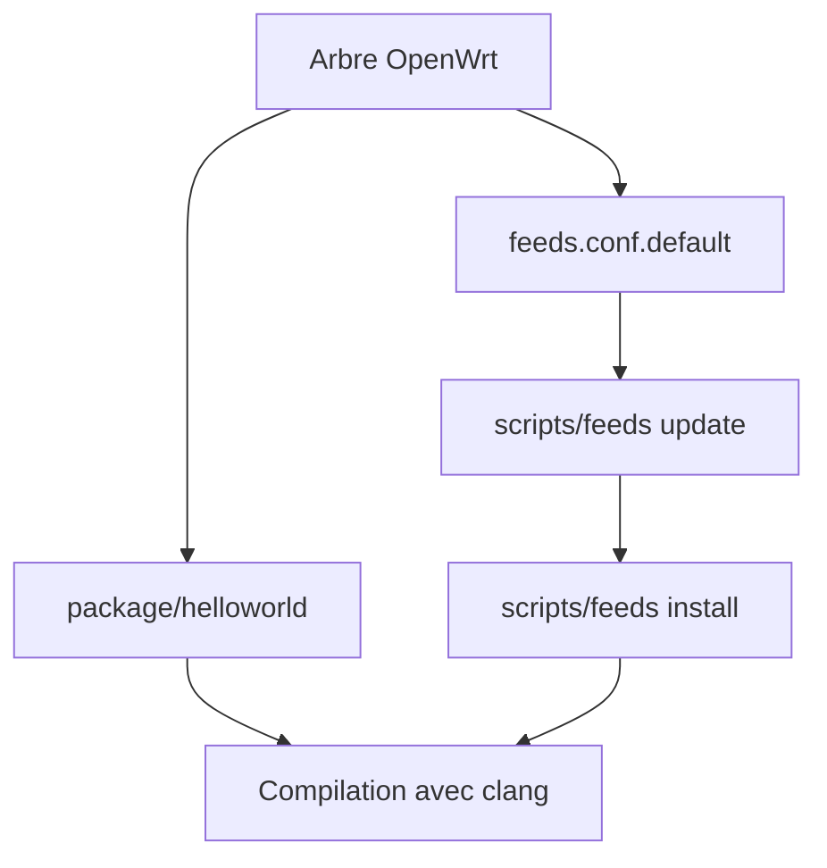

# fw876/helloworld

> Dépôt de paquets à intégrer dans une compilation OpenWrt, par clonage, sous-module ou flux.

## Le problème
Ajouter des paquets tiers à un firmware OpenWrt compilé soi-même demande de les brancher proprement dans l'arbre de compilation.

## Ce que ça fait vraiment
Le README ne décrit que l'installation : trois méthodes (clonage dans `package/helloworld`, sous-module git, flux OpenWrt), avec la mise à jour et le retrait pour chacune. Il cite Xray-core, qu'il faut compiler avec Go 1.21 ou plus sur OpenWrt 21.02 et antérieur. Le rôle exact des paquets n'est pas documenté.

## Comment c'est branché
Schéma simplifié d'après la fiche, sans diagramme fourni.


## Essayer
```bash
rm -rf package/helloworld
git clone --depth=1 https://github.com/fw876/helloworld.git package/helloworld
git -C package/helloworld pull
```

## Coût et pièges
Gratuit. Il faut installer clang, avoir une chaîne de compilation OpenWrt et, pour les versions anciennes, mettre à jour Go à la main.

## Ce que ce n'est pas
Ce n'est pas un logiciel autonome ni un firmware : c'est un complément pour qui compile déjà OpenWrt. Sa fonction n'est pas expliquée par le README.

## Alternatives
Aucune alternative nommée dans le README.

## Pour toi
À ignorer : réservé à la compilation de firmwares de routeur, sans lien avec un flux data, IA ou MLOps.

