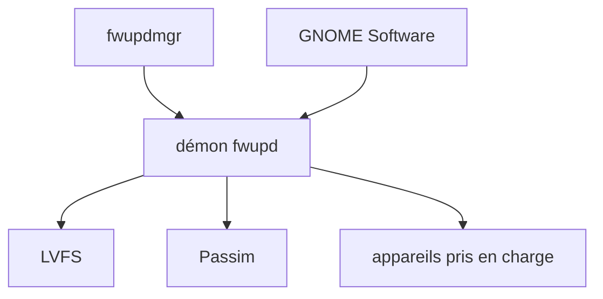

# fwupd/fwupd

> Daemon that automatically updates firmware on Linux, via the LVFS service.

## The problem
Firmware updates (BIOS, peripherals) are scattered and rarely automated on Linux.

## What it actually does
fwupd detects supported devices, downloads metadata from the LVFS service and applies updates, some live, others at the next reboot. It provides the `fwupdmgr` client, a list of approved updates for enterprises and optional reporting of results to LVFS. With Passim, it can republish the metadata on the local network.

## How it is wired
Simplified diagram based on the sheet, no diagram provided.


## Trying it
```bash
fwupdmgr get-devices
fwupdmgr refresh
fwupdmgr get-updates
fwupdmgr update
fwupdmgr report-history
```

## Cost and gotchas
Free. The README advises against building it yourself: go through your distribution. If Passim is installed, the metadata is served on `0.0.0.0:27500`; disable with `P2pPolicy=none`.

## What it is not
Not a general system update tool: it only handles firmware. Snap and Flatpak do not replace the distribution's version.

## Alternatives
No alternative named in the README.

## For you
Ignore as a repository to follow: it already ships with your distribution, mostly useful for keeping GPU machines or servers up to date.
