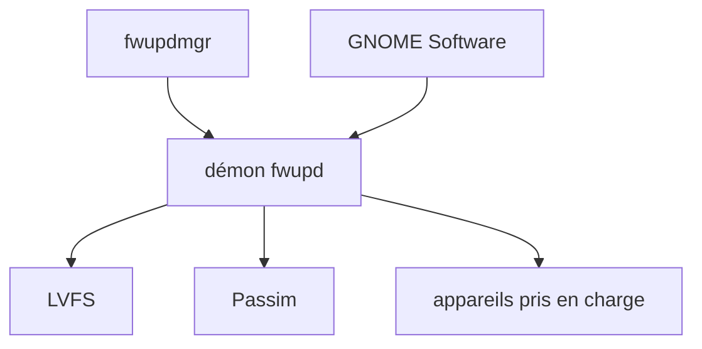

# fwupd/fwupd

> Démon qui met à jour automatiquement les microprogrammes sous Linux, via le service LVFS.

## Le problème
Les mises à jour de microprogrammes (BIOS, périphériques) sont dispersées et rarement automatisées sous Linux.

## Ce que ça fait vraiment
fwupd détecte les appareils pris en charge, télécharge les métadonnées du service LVFS et applique les mises à jour, certaines à chaud, d'autres au prochain redémarrage. Il fournit le client `fwupdmgr`, une liste de mises à jour approuvées pour les entreprises et le signalement facultatif des résultats à LVFS. Avec Passim, il peut republier les métadonnées sur le réseau local.

## Comment c'est branché
Schéma simplifié d'après la fiche, sans diagramme fourni.


## Essayer
```bash
fwupdmgr get-devices
fwupdmgr refresh
fwupdmgr get-updates
fwupdmgr update
fwupdmgr report-history
```

## Coût et pièges
Gratuit. Le README déconseille de compiler soi-même : passer par la distribution. Si Passim est installé, les métadonnées sont servies sur `0.0.0.0:27500` ; désactivation par `P2pPolicy=none`.

## Ce que ce n'est pas
Ce n'est pas un outil de mise à jour du système en général : il ne gère que les microprogrammes. Snap et Flatpak ne remplacent pas la version de la distribution.

## Alternatives
Aucune alternative nommée dans le README.

## Pour toi
À ignorer comme dépôt à suivre : il est déjà livré par la distribution, utile surtout pour maintenir les machines GPU ou serveurs à jour.

