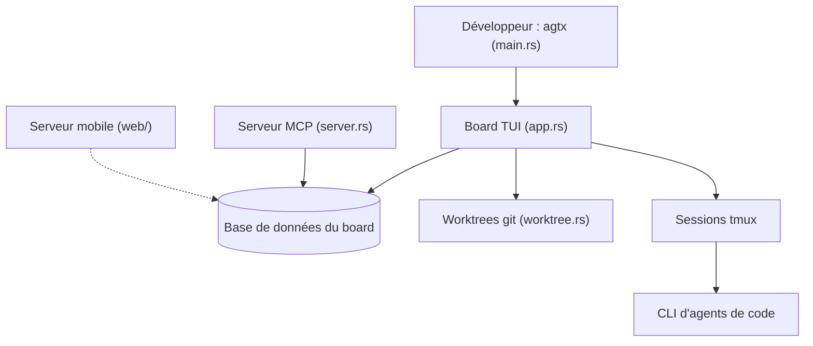

# fynnfluegge/agtx

> Terminal kanban board that hands tasks to several coding agents in parallel.

## The problem
Running several coding agents on several tasks forces you to juggle terminals, branches and contexts, with no overview.

## What it actually does
agtx displays a kanban (backlog, planning, running, review, done). Each task runs in its own git worktree and tmux window, with the agent chosen per phase (for example Gemini for research, Claude for code, Codex for review). It detects merge conflicts, offers workflow plugins (spec-kit, BMAD, GSD...), an MCP server, an experimental orchestrator, a mobile web server (QR, Tailscale) and the /agtx:oneshot skill, which carries out a complete plan unattended.

## How it is wired


## Trying it
```bash
curl -fsSL https://raw.githubusercontent.com/fynnfluegge/agtx/main/install.sh | bash
cd your-project && agtx
```

## Cost and gotchas
Free, but each agent has its own subscription or key. tmux is required, gh is optional. A full oneshot run lasts hours and many agent turns.

## What it is not
Not an agent: it orchestrates third-party agents. The mobile server gives access to everything (tasks, diffs, terminals), hence to code execution: only open it to paired devices. The orchestrator is experimental.

## Alternatives
No alternative cited in the README.

## For you
Worth watching: interesting for parallelizing coding agents with isolated worktrees, but young, single-maintainer, and costly in tokens.
