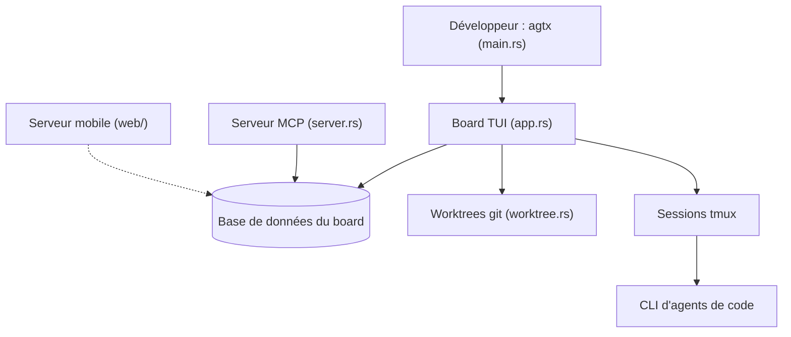

# fynnfluegge/agtx

> Tableau kanban en terminal qui confie des tâches à plusieurs agents de code en parallèle.

## Le problème
Lancer plusieurs agents de code sur plusieurs tâches oblige à jongler entre terminaux, branches et contextes, sans vue d'ensemble.

## Ce que ça fait vraiment
agtx affiche un kanban (backlog, planning, running, review, done). Chaque tâche tourne dans son propre git worktree et sa fenêtre tmux, avec l'agent choisi par phase (par exemple Gemini pour la recherche, Claude pour le code, Codex pour la revue). Il détecte les conflits de merge, propose des plugins de flux (spec-kit, BMAD, GSD...), un serveur MCP, un orchestrateur expérimental, un serveur web mobile (QR, Tailscale) et la compétence /agtx:oneshot, qui mène un plan complet sans surveillance.

## Comment c'est branché


## Essayer
```bash
curl -fsSL https://raw.githubusercontent.com/fynnfluegge/agtx/main/install.sh | bash
cd your-project && agtx
```

## Coût et pièges
Gratuit, mais chaque agent a son abonnement ou sa clé. tmux est requis, gh est optionnel. Un run complet d'oneshot dure des heures et de nombreux tours d'agent.

## Ce que ce n'est pas
Pas un agent : il orchestre des agents tiers. Le serveur mobile donne accès à tout (tâches, diffs, terminaux), donc à de l'exécution de code : ne l'ouvre qu'aux appareils appairés. L'orchestrateur est expérimental.

## Alternatives
Aucune alternative citée dans le README.

## Pour toi
À surveiller : intéressant pour paralléliser des agents de code avec des worktrees isolés, mais jeune, à mainteneur unique, et coûteux en jetons.

