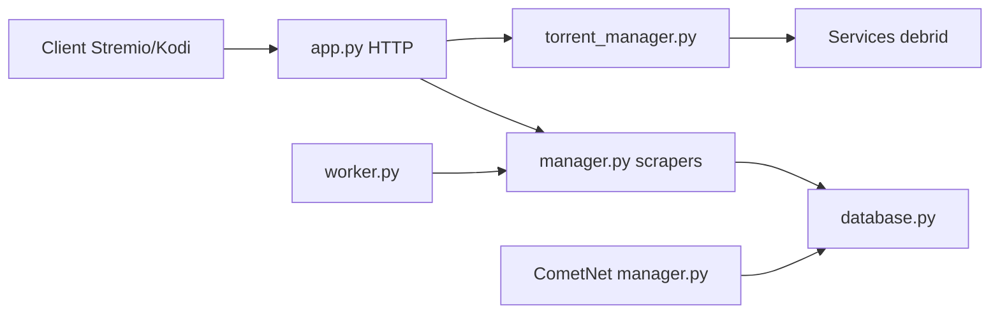

# g0ldyy/comet

> Stremio addon that aggregates torrent sources and streams them through debrid services.

## The problem
Finding reliable torrent streams for Stremio, Kodi or Prowlarr requires multiplying scrapers.

## What it actually does
Self-hosted server that queries many scrapers, ranks torrents, caches them (SQLite or PostgreSQL) and serves streams through debrid services (Real-Debrid, AllDebrid, TorBox…). Offers a Kodi interface, Torznab, a dashboard and CometNet, a P2P network for sharing metadata.

## How it is wired


## Trying it
```bash
git clone https://github.com/g0ldyy/comet
cd comet
pip install uv
uv sync
uv run python -m comet.main
```

## Cost and gotchas
A debrid subscription is generally required. Many environment variables.

## What it is not
Provides neither files nor content: it aggregates torrent metadata.

## Alternatives
No alternative named as such; the README cites Jackett, Prowlarr and Torrentio among the supported scrapers.

## For you
Ignore: it serves torrent downloading and has nothing to do with data, AI or MLOps.
