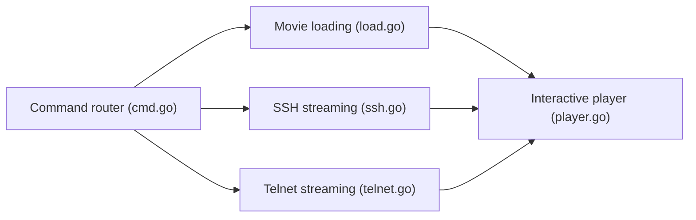

# gabe565/ascii-movie

> Streams the Star Wars movie in ASCII in a terminal, over SSH or Telnet.

## The problem
No practical problem: it is terminal entertainment.

## What it actually does
Go CLI: `play` plays a movie in the terminal with an interactive interface (keyboard, mouse), `serve` hosts SSH and Telnet servers. Embedded movies or local files, a metrics API for `get stream`. A public instance is listed at `starwarstel.net`.

## How it is wired


## Trying it
```bash
ssh starwarstel.net
telnet starwarstel.net
docker run --rm -it ghcr.io/gabe565/ascii-movie play
sudo docker run --port=22:22 --port=23:23 ghcr.io/gabe565/ascii-movie serve
```

## Cost and gotchas
Free. Ports 22/23 for hosting; the README mentions an SSH server on 2222 and uses 22 in the example.

## What it is not
Not a work tool. The README is inconsistent on the SSH port (2222 then 22).

## Alternatives
Inspired by asciimation and towel.blinkenlights.nl.

## For you
Ignore: curiosity with no professional value; only the SSH/Telnet server example in Go may be instructive.
