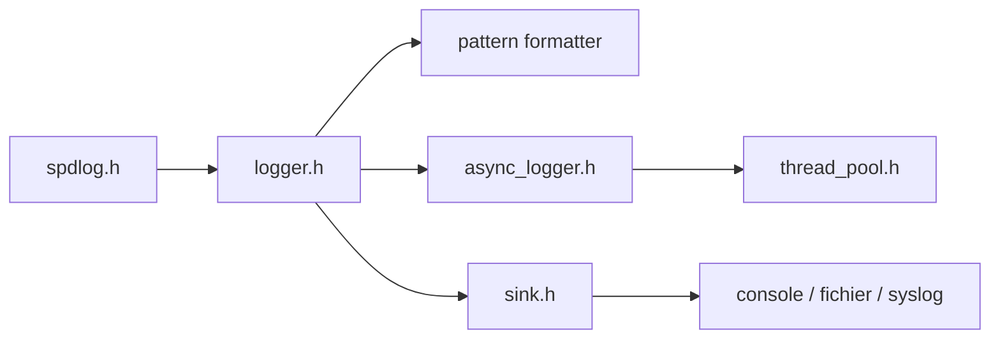

# gabime/spdlog

> C++ logging library, header-only or compiled, for C++11 and later developers.

## The problem
Writing fast, multi-threaded C++ logs with file rotation and formatting, without reinventing a home-grown system.

## What it actually does
You call the global API or a `Logger`; messages are filtered by level, formatted by `pattern_formatter` (based on fmt), then sent to one or more sinks: colored console, plain, rotating or daily files, syslog, Qt, Android. An asynchronous mode goes through a thread pool and a blocking queue. Levels can be configured through an environment variable or argv.

## How it is wired


## Trying it
```bash
git clone https://github.com/gabime/spdlog.git
cd spdlog && mkdir build && cd build
cmake .. && cmake --build .
```

## Cost and gotchas
Free. Asynchronous mode is not compatible with MDC (thread-local storage). The license is present but not recognized by GitHub: check it before redistributing.

## What it is not
Not a log aggregator or an observability tool: it writes to simple local or network destinations.

## Alternatives
No alternative named in the README.

## For you
Adopt it if you touch C++ code (inference engines, extensions): a proven reference, you only need to confirm the license.
