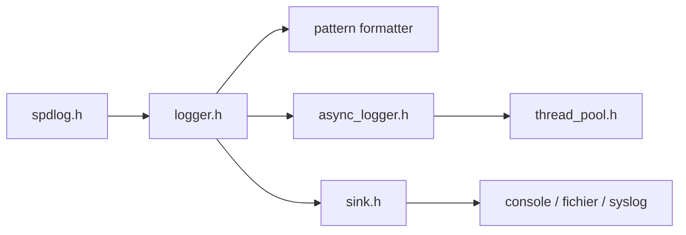

# gabime/spdlog

> Bibliothèque C++ de journalisation, en en-têtes seuls ou compilée, pour développeurs C++11 et plus.

## Le problème
Écrire des logs C++ performants, multi-threads, avec rotation de fichiers et formatage, sans réinventer un système maison.

## Ce que ça fait vraiment
On appelle l'API globale ou un `Logger`, les messages sont filtrés par niveau, formatés par `pattern_formatter` (basé sur fmt), puis envoyés à un ou plusieurs sinks : console couleur, fichiers simples, rotatifs ou journaliers, syslog, Qt, Android. Un mode asynchrone passe par un pool de threads et une file bloquante. Niveaux configurables via variable d'environnement ou argv.

## Comment c'est branché


## Essayer
```bash
git clone https://github.com/gabime/spdlog.git
cd spdlog && mkdir build && cd build
cmake .. && cmake --build .
```

## Coût et pièges
Gratuit. Le mode asynchrone n'est pas compatible avec le MDC (stockage thread-local). La licence est présente mais non reconnue par GitHub : à vérifier avant redistribution.

## Ce que ce n'est pas
Pas un agrégateur de logs ni un outil d'observabilité : il écrit dans des destinations locales ou réseau simples.

## Alternatives
Aucune alternative nommée dans le README.

## Pour toi
À adopter si tu touches du code C++ (moteurs d'inférence, extensions) : référence éprouvée, il suffit de confirmer la licence.

