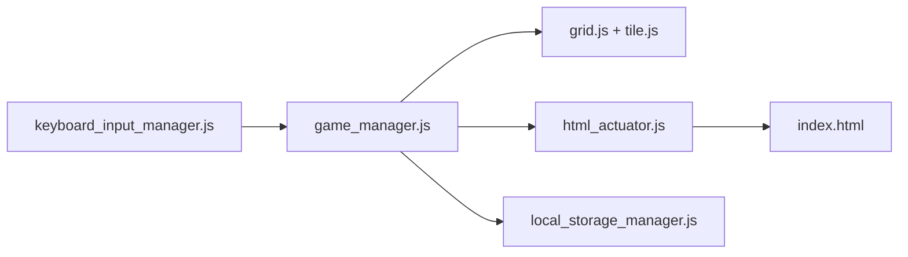

# gabrielecirulli/2048

> Small clone of the game 2048 in HTML, CSS and JavaScript, to play in the browser.

## The problem
No business problem: it is a game made for fun, according to the author.

## What it actually does
Tile game on a grid: arrow keys or touch swipes merge the tiles. `game_manager.js` orchestrates, `grid.js` and `tile.js` hold the state, `html_actuator.js` updates the DOM, `local_storage_manager.js` keeps the best score. Polyfills ensure compatibility with old browsers.

## How it is wired

## Trying it
No command: the README points to a playable online version and to the Play Store and App Store apps.

## Cost and gotchas
Free, no hosting. Last push on 2024-10-24 (more than a year ago). The README asks for BTC donations.

## What it is not
Not a reference project for AI: it is a game; no tests or modern build mentioned.

## Alternatives
No alternative cited in the README (1024 and Threes are cited as inspirations).

## For you
Ignore: a game with no professional interest, and not very active; keep it for curiosity.
