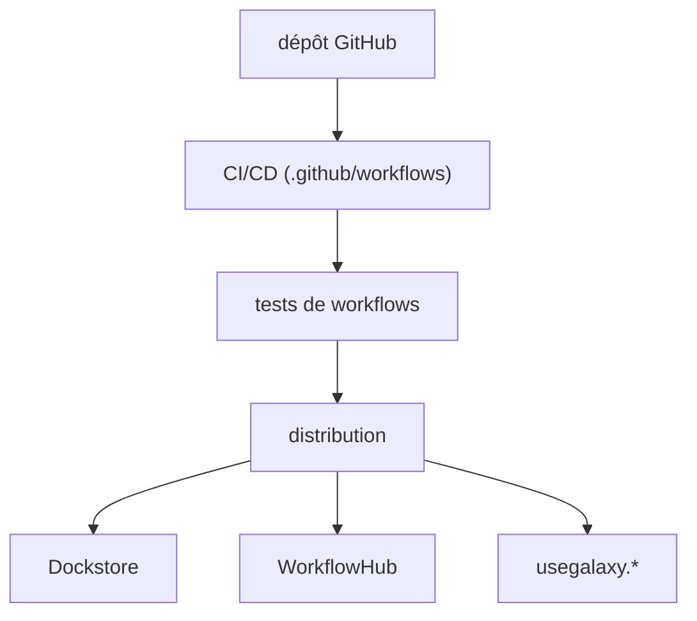

# galaxyproject/iwc

> Collection of reviewed and tested Galaxy bioinformatics workflows, published on Dockstore and WorkflowHub.

## The problem
Researchers need reliable Galaxy workflows rather than redoing each analysis by hand.

## What it actually does
The repository organizes workflows by domain (VGP assembly, bacterial genomics, transcriptomics, proteomics, variant calling). They are reviewed, tested against each Galaxy release, versioned through releases and published on Dockstore and WorkflowHub. They install automatically on the usegalaxy.org, .eu and .org.au servers.

## How it is wired

## Trying it
No command: in Galaxy, Workflows, Import, then search for `organization:iwc` (WorkflowHub) or `organization:iwc-workflows` (Dockstore).

## Cost and gotchas
You need a Galaxy instance or an account on a usegalaxy server. No license at the repository level; each workflow carries its own in its metadata.

## What it is not
Not Galaxy itself: only a library of workflows for that platform.

## Alternatives
No alternative named in the README.

## For you
Worth watching: relevant if you do bioinformatics or reproducible data pipelines on Galaxy; otherwise out of scope.
