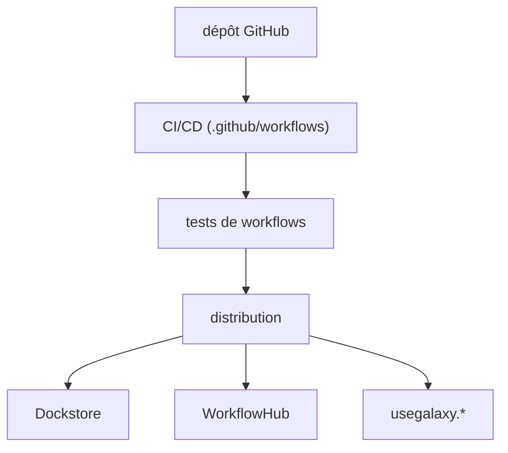

# galaxyproject/iwc

> Collection de workflows Galaxy de bioinformatique relus et testés, publiée sur Dockstore et WorkflowHub.

## Le problème
Les chercheurs ont besoin de workflows Galaxy fiables plutôt que de refaire chaque analyse à la main.

## Ce que ça fait vraiment
Le dépôt range des workflows par domaine (assemblage VGP, génomique bactérienne, transcriptomique, protéomique, appel de variants). Ils sont revus, testés à chaque version de Galaxy, versionnés par releases et publiés sur Dockstore et WorkflowHub. Ils s'installent automatiquement sur les serveurs usegalaxy.org, .eu et .org.au.

## Comment c'est branché

## Essayer
Aucune commande : dans Galaxy, Workflows, Import, puis chercher `organization:iwc` (WorkflowHub) ou `organization:iwc-workflows` (Dockstore).

## Coût et pièges
Il faut une instance Galaxy ou un compte sur un serveur usegalaxy. Aucune licence au niveau du dépôt ; chaque workflow porte la sienne dans ses métadonnées.

## Ce que ce n'est pas
Pas Galaxy lui-même : seulement une bibliothèque de workflows pour cette plateforme.

## Alternatives
Aucune alternative nommée dans le README.

## Pour toi
À surveiller : pertinent si tu fais de la bioinformatique ou des pipelines de données reproductibles sur Galaxy ; sinon hors périmètre.

