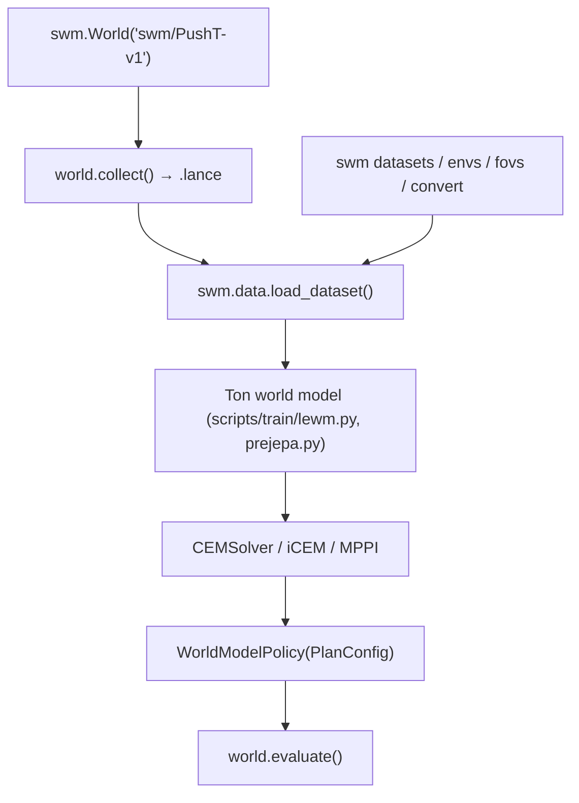

# galilai-group/stable-worldmodel

> Unified interface to collect data, train and evaluate world models in predictive control.

## The problem
Every world-model paper rewrites its data collection, its dataset format and its MPC solver, which makes comparisons impossible.

## What it actually does
Covers the three stages behind a single API: `world.collect()` records episodes, `swm.data.load_dataset()` reads them back with format autodetection, `world.evaluate()` evaluates a policy built on a solver. Five dataset formats via an extensible registry (lance by default, hdf5, folder, video, lerobot read-only) with measured throughput figures reproducible via `scripts/benchmark/compare_h5_lance.py`. Around thirty environments (DeepMind Control Suite, Gymnasium, OGBench, Craftax, 100+ Atari games, PushT, Two-Room), most shipped with visual and physical variation factors to test zero-shot generalization. Seven solvers (CEM, iCEM, MPPI, predictive sampling, SGD/Adam, PGD, augmented Lagrangian) and six baselines (DINO-WM, PLDM, LeWM, GCBC, GCIVL, GCIQL).

## How it is wired


## Trying it
```bash
pip install 'stable-worldmodel[data]'    # recommended: base + Lance dataset I/O
pip install 'stable-worldmodel[all]'     # + training, environments, and data formats
uv venv --python=3.10 && source .venv/bin/activate
uv sync --extra all --group dev
swm envs
swm fovs PushT-v1
swm convert pusht_expert_train --dest-format video
```

## Cost and gotchas
Free. The `[data]` extra pulls in the Lance stack (~410 MB of native wheels), hence its separation. LeRobot support is a separate extra requiring Python 3.12+. Datasets and checkpoints go under `$STABLEWM_HOME` (`~/.stable_worldmodel/` by default). The README warns: library under active development, API liable to change between minor versions.

## What it is not
It is not a world model: it is the harness around one. The baselines provided are reference implementations, not necessarily the papers' weights. The throughput figures apply to one specific PushT dataset and an H200, not to your hardware.

## Alternatives
- LeRobot, whose datasets are readable via the `lerobot://` adapter, for robotics.

## For you
Relevant if you do research on world models or MPC; of little use in production.
