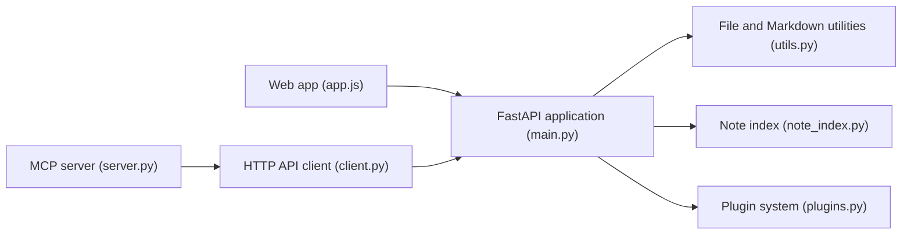

# gamosoft/NoteDiscovery

> Self-hosted Markdown note-taking web application with graph, tags and an MCP server, for personal use.

## The problem
Keep your notes in plain Markdown, under your own control, with search and links, without a commercial service.

## What it is not
Not designed to be exposed to the Internet without an HTTPS reverse proxy. No native multi-user support.

## What it actually does
A FastAPI application serves a web interface over Markdown files in folders: search, tags, backlinks, note graph, templates, LaTeX, Mermaid, drawing editor, HTML export, link sharing, plugins and themes. An MCP server exposes the notes to Claude or Cursor; a Docker Compose stack with Ollama and Open WebUI is provided.

## How it is wired


## Trying it
```bash
mkdir -p notediscovery/data && cd notediscovery
docker run -d --name notediscovery -p 8000:8000 \
  -v $(pwd)/data:/app/data \
  ghcr.io/gamosoft/notediscovery:latest
# puis http://localhost:8000
```

## Cost and gotchas
Free. Authentication is disabled by default and the default password is `admin`: enable it and change it before any network exposure. Listens on `0.0.0.0:8000`.

## Alternatives
- Notion, Evernote, Obsidian Sync: commercial services compared in the README.

## For you
Worth watching: handy for a local notes base connected to an assistant via MCP, but young (November 2025) and single-maintainer.
