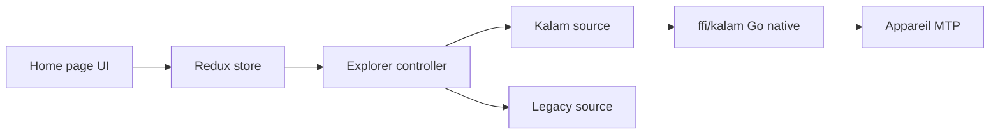

# ganeshrvel/openmtp

> macOS application to transfer files to Android and MTP devices over USB.

## The problem
Google's official Android File Transfer app caps files at 4 GB, disconnects often and does not allow renaming.

## What it actually does
Electron/React application with an MTP core written in Go ("Kalam"), dual Mac/device pane, drag and drop, files over 4 GB, dark theme. Claims 30 to 40 MB/s on modest devices and 100 to 120 MB/s on high-end ones. The architecture reveals Sentry, Google Analytics and Mixpanel, whereas the README says it collects no personal data.

## How it is wired


## Trying it
```bash
brew install openmtp --cask
```

## Cost and gotchas
Free. macOS 11 minimum. Building from source requires Node 16, Yarn and Sentry CLI; publishing requires Apple signing and notarization.

## What it is not
Not cross-platform (macOS only). Not a Wi-Fi or ADB solution: it is USB/MTP.

## Alternatives
Google's Android File Transfer app is cited, only for its limitations.

## For you
Ignore: macOS desktop utility unrelated to data/AI/MLOps work.
