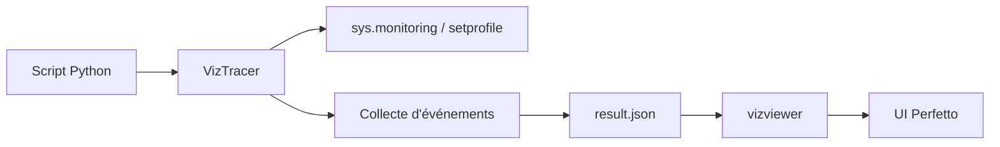

# gaogaotiantian/viztracer

> Low-overhead Python tracer that visualizes execution on a Perfetto timeline.

## The problem
cProfile gives aggregates, not a chronology: it is hard to understand threads, async or PyTorch calls.

## What it actually does
It records every function entry and exit; `vizviewer` serves the report on localhost:9001.
It handles threading, multiprocessing, async, and PyTorch via `--log_torch` (GPU events).
Filters (depth, files, minimum duration), variable logging without modifying the code, custom events.
Jupyter magics, remote attach, VS Code extension.

## How it is wired


## Trying it
```bash
pip install viztracer
viztracer my_script.py arg1 arg2
vizviewer result.json
viztracer --log_torch your_model.py
```

## Cost and gotchas
Free. The overhead can reach 3 to 4x on highly recursive code; install `orjson` to speed up saving.

## What it is not
Not a sampling profiler: it traces everything, so it is slower than a sampler.

## Alternatives
- cProfile: the standard profiler, less detailed.

## For you
Adopt it for debugging a slow data pipeline or PyTorch training run: the timeline shows what an aggregated profile hides.
