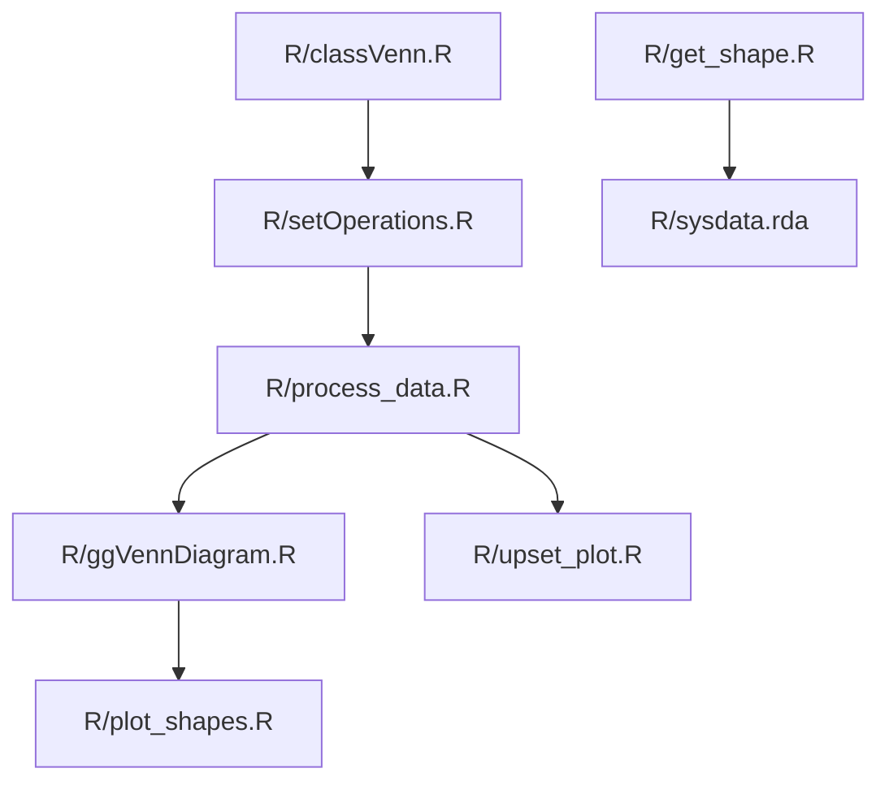

# gaospecial/ggVennDiagram

> R package that draws Venn diagrams of 2 to 7 sets and UpSet plots.

## The problem
Comparing lists (genes, identifiers) by intersections requires readable, publishable figures, and ggplot2 has no native Venn.

## What it actually does
`ggVennDiagram(x)` takes a named list of sets and returns an editable ggplot object. It colors each region according to its count, computes the intersection values (`process_region_data`) and switches to UpSet beyond 7 sets. A Shiny app is provided.

## How it is wired


## Trying it
```bash
Rscript -e 'install.packages("ggVennDiagram")'
```
```r
library(ggVennDiagram)
ggVennDiagram(x)
ggVennDiagram::launch_app()
```

## Cost and gotchas
Requires R. GPL-3.0 license (copyleft). Venn diagrams with more than 4 sets may omit regions, as the README acknowledges.

## What it is not
Not a statistical tool: it draws intersections, it tests nothing. Not for Python.

## Alternatives
The `venn` package by Adrian Dușa, whose 5 to 7 set shapes are reused.

## For you
Watch: useful if you do analysis in R with lists of genes or identifiers, useless otherwise.
