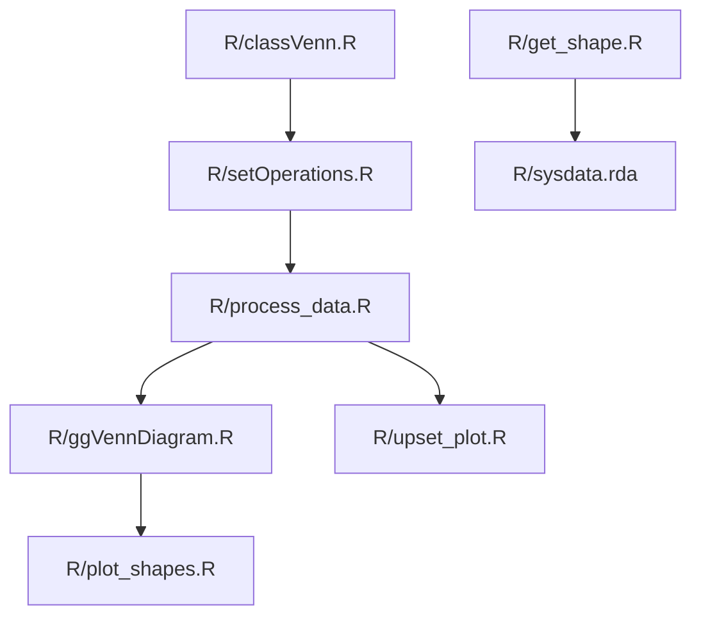

# gaospecial/ggVennDiagram

> Package R qui trace des diagrammes de Venn de 2 à 7 ensembles et des graphes UpSet.

## Le problème
Comparer des listes (gènes, identifiants) par intersections demande des figures lisibles, publiables, et ggplot2 n'a pas de Venn natif.

## Ce que ça fait vraiment
`ggVennDiagram(x)` prend une liste nommée d'ensembles et renvoie un objet ggplot modifiable. Il colore chaque région selon son effectif, calcule les valeurs d'intersection (`process_region_data`) et bascule en UpSet au-delà de 7 ensembles. Une appli Shiny est fournie.

## Comment c'est branché


## Essayer
```bash
Rscript -e 'install.packages("ggVennDiagram")'
```
```r
library(ggVennDiagram)
ggVennDiagram(x)
ggVennDiagram::launch_app()
```

## Coût et pièges
Nécessite R. Licence GPL-3.0 (copyleft). Les Venn à plus de 4 ensembles peuvent omettre des zones, le README le reconnaît.

## Ce que ce n'est pas
Pas un outil statistique : il dessine des intersections, il ne teste rien. Pas pour Python.

## Alternatives
Le package `venn` d'Adrian Dușa, dont les formes à 5 à 7 ensembles sont reprises.

## Pour toi
Surveiller : utile si tu fais de l'analyse en R avec des listes de gènes ou d'identifiants, inutile sinon.

