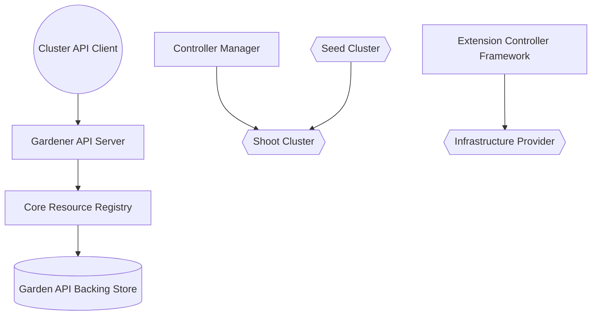

# gardener/gardener

> Kubernetes-native platform that creates and operates Kubernetes clusters "as a service" across multiple infrastructures.

## The problem
Managing dozens of homogeneous Kubernetes clusters across several clouds without dedicated masters or per-provider tooling.

## What it actually does
Gardener adds an extended API server and controllers to a "garden" cluster. A user cluster ("shoot") is described by a declarative specification. Its control plane (etcd, API server, controller manager, scheduler) runs as a Kubernetes workload in a "seed" cluster, with no master VMs. An extension framework carries the provider-specific work, an operator installs the landscape, and the project takes part in the Kubernetes conformance tests.

## How it is wired

## Trying it
No command documented in the README: it points to `/docs` and to the guide for setting up a Gardener landscape.

## Cost and gotchas
Free, but the infrastructure (garden and seed clusters, cloud accounts) is entirely at your expense, and operating a landscape requires a platform team.

## What it is not
Not a tool for running applications or models: it builds the clusters that host them. Not equivalent to Cluster API: the README insists on the difference.

## Alternatives
- Cluster API (SIG Cluster Lifecycle): harmonizes cluster creation, not their composition.

## For you
Ignore: this is cluster fleet management for platform teams, very far from a daily data / AI / MLOps routine, unless your organization already runs it.
