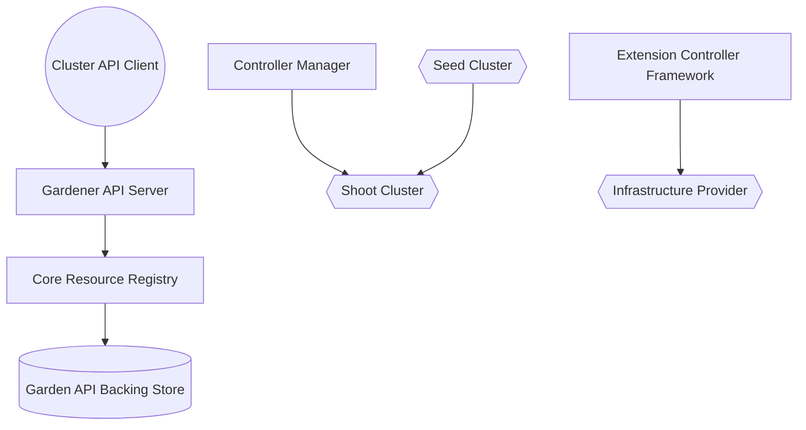

# gardener/gardener

> Plateforme Kubernetes-native qui crée et exploite des clusters Kubernetes « as a service » sur plusieurs infrastructures.

## Le problème
Gérer des dizaines de clusters Kubernetes homogènes sur plusieurs clouds sans maîtres dédiés ni outils par fournisseur.

## Ce que ça fait vraiment
Gardener ajoute à un cluster « garden » un serveur d'API étendu et des contrôleurs. On y décrit un cluster utilisateur (« shoot ») par une spécification déclarative. Son plan de contrôle (etcd, API server, controller manager, scheduler) tourne comme charge Kubernetes dans un cluster « seed », sans VM maîtres. Un framework d'extensions porte le travail propre à chaque fournisseur, un opérateur installe le paysage, et le projet participe aux tests de conformité Kubernetes.

## Comment c'est branché

## Essayer
Aucune commande documentée dans le README : il renvoie à `/docs` et au guide de mise en place d'un paysage Gardener.

## Coût et pièges
Gratuit, mais l'infrastructure (clusters garden et seed, comptes cloud) est entièrement à ta charge, et l'opération d'un paysage demande une équipe plateforme.

## Ce que ce n'est pas
Pas un outil pour exécuter des applications ou des modèles : il fabrique les clusters qui les hébergent. Pas équivalent à Cluster API : le README insiste sur la différence.

## Alternatives
- Cluster API (SIG Cluster Lifecycle) : harmonise la création des clusters, pas leur composition.

## Pour toi
À ignorer : c'est de la gestion de flotte de clusters pour équipes plateforme, très loin d'un quotidien data / IA / MLOps, sauf si ton organisation l'exploite déjà.

